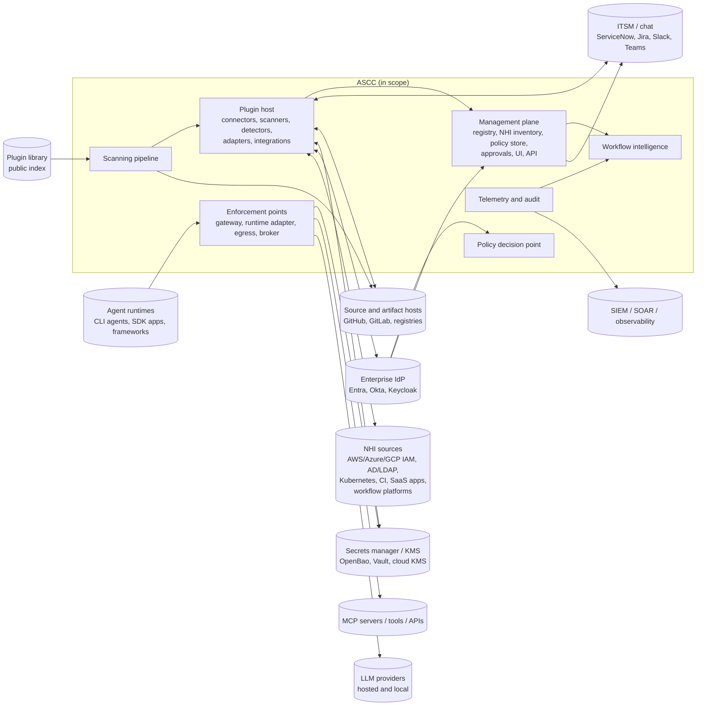

# A. Product charter

[Package index](README.md) · Next: [B. Discovery questions](b-discovery-questions.md)

## 1. Mission

Give an enterprise **provable control** over what its AI agents can do: who they are, who they act for, what
they may call, what data they may move, what they are made of, and how to stop them. ASCC is a vendor-neutral,
self-hostable control plane plus a set of enforcement points. It does not run models or agents; it governs the
boundaries agents cross. **[C]**

**North star [C]:** every AI identity, capability, connection, permission, action and security decision is
discoverable, attributable, governed and auditable.

**Product thesis [R]:** the market already has LLM proxies (cost, routing, redaction) and already has IAM. What
it lacks is the join: a per-action authorization decision that knows the *human* who started the task, the
*chain of agents* it passed through, the *tool* and *data* at the end, and the *supply-chain state* of everything
in between, enforced at more than one choke point and honest about where it can't see.

**Three extensions to the thesis [C, 2026-11-09]:**

1. **The join must reach every system that holds a non-human identity.** An agent's authority is only as
   governed as the service accounts, keys, roles and app registrations it ultimately uses, and those live in
   clouds, identity providers, vaults and on-premise directories. ASCC therefore ships **connectors** that
   aggregate NHI data from those platforms into one inventory and push lifecycle actions back.
2. **The join is built to be extended by other people.** Connectors, scanners, detectors, runtime adapters,
   notification channels and console panels are **plugins** on a published, versioned, capability-scoped
   contract. The plugin platform is a headline feature with its own SDK, library and developer programme, not an
   internal convenience.
3. **Seeing every workflow is worth more than securing each one in isolation.** With agents, tools, data
   sources and schedules in one registry and their calls in one telemetry stream, ASCC can show where two or
   more workflows do the same job and propose **consolidation**, which removes cost, credentials and attack
   surface at once.

**Two more, from the 2026-11-09 requirements review [C]:** Mike's stated purpose is *agent management within an
enterprise, and governing non-human accounts, AI agents included*.

4. **An AI agent is a non-human identity, and is governed as one.** Agents, their instances and the identities
   platforms issue to them sit in the same inventory as service accounts and keys, with the same owner, review,
   expiry and offboarding rules. One population, one review.
5. **Managing a fleet means knowing each runtime's posture, not only its policy.** A policy is enforced on a
   machine only while the hook that asks for it can't be switched off there. ASCC checks that per host, generates
   the managed settings that make it true, and puts a changed agent back through review. It does not deploy
   settings: device management does.

## 2. Target personas

| Persona | Owns | Top jobs | Primary screens |
|:--|:--|:--|:--|
| **AI security architect** (primary buyer-user) | AI risk posture | Set policy, see coverage gaps, approve high-risk grants | Policy workbench, coverage map, identity graph |
| **IAM / IGA / PAM engineer** | Human and non-human identity | Bind agent identities, configure delegation, run access reviews, **govern NHIs across platforms** | Identity graph, **NHI inventory**, access reviews |
| **SOC analyst / incident responder** | Detection and response | Triage alerts, reconstruct sessions, pull the kill switch | Live sessions, incidents, kill panel |
| **AppSec / supply-chain engineer** | Third-party code, **including plugins** | Triage scan findings, grant expiring exemptions, quarantine, **approve plugin installs** | Scan queue, findings, **plugin catalog** |
| **AI platform engineer** | Gateways, runtimes, **connectors** | Deploy PEPs, onboard providers, **configure connectors**, watch SLOs | Fleet health, provider config, **connector health** |
| **Automation / workflow owner** [new] | A team's agents and automations | See what their workflows cost and overlap with, act on consolidation proposals | **Workflow map, optimization inbox** |
| **Agent developer** | An agent or tool | Register it, understand a deny, request access | Catalog, "why was I denied", access request |
| **Plugin developer** [new] (internal or third party) | A plugin | Scaffold, test and publish a plugin; see installs and issues | **Plugin SDK, dev harness, library listing** |
| **Agent / resource owner** | Business accountability | Approve access to their resource, certify grants | Approval inbox |
| **Compliance / audit / DPO** | Evidence | Export evidence, run legal hold, answer "who did what" | Audit search, evidence packs |

## 3. Use cases (ranked)

| # | Use case | Why it ranks here | Phase |
|:--|:--|:--|:--|
| U1 | **Deny an unauthorized tool call before it runs**, with a reason the developer can read | The core preventive control; everything else supports it | MVP |
| U2 | **Contain a misbehaving agent** in one action, with confirmed propagation | Kill switch is the second thing every buyer asks for | MVP |
| U3 | **Trace a delegated action** from human through agents to tool and credential | Accountability; required for audit and incident response | MVP |
| U4 | **Gate a new MCP server, skill or plugin** on scan results and approval | Supply chain is the most likely real-world compromise path | MVP (static) |
| U5 | **Stop credential exposure** by brokering secrets instead of handing them to agents | Removes the highest-value thing an injected agent can steal | MVP (one integration) |
| U6 | **Block exfiltration destinations** at egress | Backstop when a tool or runtime bypasses the gateway | MVP |
| U7 | **Inventory and find shadow AI** (unregistered MCP servers, keys, agents) | Can't govern what you can't see | MVP (config files, two connectors) / P1 |
| U8 | **Run access reviews and JIT grants** for agents | IGA parity for non-human identities | Phase 2 |
| U9 | **DLP on prompts, responses and tool results** | High demand, but mostly probabilistic; ship after deterministic controls | Phase 2 |
| U10 | **Produce compliance evidence packs** | Value depends on U1 to U6 existing first | Phase 2 to 3 |
| U11 | **Explainable trust and risk scores** | Useful for prioritization; dangerous if it grants access | Phase 4 |
| U12 | **Govern multi-agent workflows** (depth, budgets, SoD, loop detection) | Partly in MVP (depth, budgets), full in Phase 4 | MVP partial |
| **U13** | **Aggregate and manage NHIs across clouds and on-premise systems**: one inventory of service accounts, keys, roles, app registrations and vault roles; which agents use each; ownerless, stale and over-privileged ones flagged; disable, rotate and revoke through the same connectors **[C]** | An agent is governed only as far as its credentials are; NHIs outnumber humans and nobody owns most of them | MVP (SDK + two read-only connectors) / Phase 2 (cloud connectors, lifecycle actions) |
| **U14** | **Extend ASCC with a plugin**: a developer scaffolds a connector, scanner, detector, adapter or integration from a template, tests it against a local harness, submits it, and it appears in the library after an automated scan and review **[C]** | Coverage grows with the number of connectors and adapters; the core team can't write them all; a visible ecosystem is a buying signal | MVP (contract, SDK, harness, two in-house plugins) / Phase 2 (library launch) |
| **U15** | **Find redundant workflows and propose consolidation**: show where several agents or automations solve the same use case with overlapping tools, data and schedules, with the savings and risk reduction of merging them **[C]** | Each duplicate is extra cost, extra NHIs and extra attack surface; ASCC is the one system that sees them all | Phase 2 (deterministic overlap) / Phase 3 (semantic) |
| **U16** | **Run the agent fleet**: every agent in a group with a policy profile, each host's runtime posture checked, a changed agent re-reviewed, an owner who leaves hands over, a pilot agent expires **[C, 2026-11-09 review]** | "Agent management" is the stated purpose; without it ASCC governs one agent at a time | MVP (groups, posture for one runtime, PEP self-protection) / Phase 2 (managed-config generation, change control, transfer, expiry) |
| **U17** | **See agents as NHIs, including the ones on vendor platforms**: one non-human list with agents in it; agents built on SaaS and cloud agent services inventoried as `observed` **[C, 2026-11-09 review]** | The agents an enterprise can't put a hook in front of are the ones nobody has listed | MVP (unified view, inventory-document import) / Phase 2 (agent-platform connectors) |

## 4. Value proposition and differentiators

| Differentiator | What it means concretely | Competing approach it beats |
|:--|:--|:--|
| **Pre-execution, per-action authorization** | Every `tools/call`, LLM request and brokered credential use gets an allow/deny/approve decision | Post-hoc log analysis |
| **Delegation that only narrows** | Effective permission = intersection of initiator, agent grant, task scope and policy | Agents running on a shared service account |
| **Coverage as a first-class metric** | Each asset and path is labelled *enforced*, *observed* or *unmonitored*; the dashboard shows the unmonitored parts | Dashboards that imply full visibility |
| **Supply-chain state feeds runtime policy** | A quarantined MCP server or plugin is denied at the gateway within the propagation SLO | Scanners that file tickets nobody links to runtime |
| **Confirmed kill** | Kill status is per-PEP: requested, propagated, acknowledged, or unconfirmed | "Disable" buttons with no proof |
| **Self-hosted, vendor-neutral** | Runs air-gapped; any OpenAI-compatible or Anthropic-style provider; local models | SaaS-only AI gateways |
| **One NHI inventory, many platforms** [new] | Connectors reconcile the same service account seen by a vault, a cloud IAM and an IdP into one record with an owner, usage, age and the agents that use it; lifecycle actions go back through the connector | NHI tools that stop at inventory, and AI gateways that never see the credential store |
| **Open plugin platform** [new] | Published gRPC contract, SDKs in Go, Python and TypeScript, a local dev harness, a conformance suite, signed and scanned plugins, a public library with verified tiers; the core team's own connectors are built on it | Closed integration lists that grow at the vendor's pace |
| **Workflow intelligence** [new] | Overlap findings with evidence (shared tools, data sources, destinations, schedules, purpose similarity) and a consolidation proposal routed to the owners; advisory, never automatic | Cost dashboards that show spend without showing why it's duplicated |
| **Explainable decisions and evidence-backed trust** [DS] | Every allow/deny and every score traces to a policy ID, a reason and evidence | Opaque risk scores |

## 5. System boundaries

| In scope | Out of scope (integrate, don't build) | Out of scope (won't do) |
|:--|:--|:--|
| Registry, discovery, relationship graph | Human identity (IdP is authoritative) | Hosting, training or fine-tuning models |
| Non-human identity issuance and delegation tokens | Secret storage (vault is authoritative) | Generic API gateway or firewall product |
| **NHI inventory aggregated through connectors; lifecycle actions executed through the owning platform** | **The platforms themselves** (ASCC never becomes the IAM of record for AWS, Entra or AD) | **A full IGA or PAM replacement** |
| Policy authoring, simulation, decision, decision logs | SIEM correlation and long-term log analytics | Endpoint detection and response (EDR) |
| Enforcement points for LLM, MCP, A2A, local runtime, egress | Ticketing and case management | Certifying legal or regulatory compliance |
| Static and sandboxed supply-chain scanning, **applied to plugins too** | Vulnerability databases (consume OSV, GitHub advisories) | Inventing MCP/A2A/OAuth protocol extensions |
| Audit log, traces, evidence export | Enterprise DLP engines (optional integration) | Guaranteeing control over agents that bypass every PEP |
| Kill switch and containment orchestration | SOAR playbook engines | Content moderation for end-user chat products |
| **Plugin contract, SDKs, host, library index, verification pipeline** | **Plugin hosting for third parties** (plugins run in the customer's deployment) | **Plugins that change authorization outcomes** (plugins supply signals and obligations' inputs, never permits) |
| **Workflow fingerprints, overlap detection, consolidation proposals** | **Workflow editing** (changes happen in the owning platform) | **Automatic merging or retiring of workflows** |

## 6. Prioritized capability map

Priority: **P0** in MVP, **P1** Phase 2, **P2** Phase 3+, **R** research. Mode: ⛔ prevent / 🔍 detect.

| Capability area | P0 (MVP) | P1 | P2 / R |
|:--|:--|:--|:--|
| **Registry and discovery** | Manual + API registration; lifecycle states; owner required; config-file discovery of local MCP servers 🔍 (as a plugin) | Cloud/SCM/IdP discovery connectors; drift alerts; attestations | Network-traffic shadow-AI detection 🔍 (R) |
| **NHI connectors** [new] | Connector contract; **two read-only connectors** (OpenBao/Vault credential refs and roles; GitHub Apps, installations and deploy keys **[V]**); NHI record type; AI-linkage edges; coverage per connector 🔍 | AWS IAM, Entra ID / Azure, GCP, Okta, Kubernetes service accounts, Active Directory / LDAP, CI secrets (GitHub Actions, GitLab), workflow platforms (n8n and peers); **cross-source reconciliation**; ownerless / stale / over-privileged findings 🔍; **lifecycle actions** (disable, rotate, revoke) with approval ⛔ | IGA/PAM connectors (SailPoint, CyberArk); data platforms (Snowflake, Databricks); SaaS admin APIs; usage-based right-sizing proposals |
| **Plugin platform** [new] | **v1alpha1 plugin contract** (gRPC), Go SDK, local dev harness, conformance suite, out-of-process host with capability-scoped tokens and health, install gated by scan + approval ⛔, kill switch can disable a plugin ⛔; the two connectors and the config collector ship as plugins | Python and TypeScript SDKs; plugin types: scanner, detector, notification, console panel, policy pack; **public library** with verified tiers, submission pipeline, docs site, template repo; developer programme launch | WASM in-process plugins for hot-path detectors with a latency budget; runtime-adapter plugins for new agent CLIs; partner certification |
| **Fleet management** [new, 2026-11-09 review] | Agent groups as policy targets; runtime posture check for the MVP runtime 🔍; policy forbids the agent touching its own PEP ⛔; agents in the NHI view; containment lists the NHIs left standing | Managed-settings generation per runtime; change control on approved agents ⛔; ownership transfer; expiry ⛔; declarative manifests; vendor-hosted agent connectors 🔍 | Posture attested by the OS or device management instead of self-reported (R) |
| **Workflow intelligence** [new] | Workflow fingerprint fields captured on agents and discovered automations (trigger, inputs, tools, destinations, schedule, purpose) so data accumulates | **Deterministic overlap detection** (shared tool sets, data sources, destinations, schedules, duplicated credentials); idle workflows; optimization inbox with accept / dismiss / snooze 🔍 | Semantic similarity of purpose and prompts (local embeddings) 🔍; chain-collapse and shared-service proposals; savings estimates calibrated against accepted proposals (R) |
| **Identity and delegation** | OIDC login; agent identity records; token exchange with actor chain; intersection rule ⛔; max depth ⛔ | JIT grants, access requests, access reviews, SoD rules, SCIM; **SPIFFE/SPIRE for server agents** [DS, pulled forward] | PAM session brokering |
| **Policy** | Cedar policies; deny-overrides; decision log; explain API | Policy simulation against recorded traffic; policy tests in CI; policy packs as plugins | Formal policy analysis (R) |
| **LLM gateway** | Anthropic Messages + OpenAI-compatible adapters; authN, model allowlist ⛔, token budget ⛔, metering | Multi-provider routing/fallback; per-tenant quotas; streaming DLP | Semantic caching (non-goal unless asked) |
| **MCP gateway** | Streamable HTTP proxy as OAuth 2.1 resource server [DS]; `tools/list` filtering ⛔; per-call authz ⛔; argument rules ⛔; tool-description pinning ⛔ | Result inspection; approval-in-the-loop for high-risk calls | Elicitation/sampling governance |
| **A2A gateway** | Registry entries + observe-only [DS] | Agent Card validation; task-level authz ⛔ | Cross-org federation |
| **Local runtime adapter** | One CLI agent's pre-tool hook ⛔; stdio MCP wrapper ⛔ | Second runtime; SDK interceptors (Python, TS); adapters as plugins | OS-level mediation (eBPF, endpoint) (R) |
| **Egress control** | Default-deny forward proxy for managed runtimes ⛔ | Per-agent egress policy from PDP | TLS inspection (optional, high cost) |
| **Secrets** | One broker integration (OpenBao/Vault); credential injection at gateway ⛔ | Dynamic DB/cloud creds; leak detection 🔍; cloud secret managers via connectors | PAM integration |
| **Supply-chain scanning** | Static: secrets, deps, prompt-injection patterns, unsafe shell, manifest permissions; quarantine gate ⛔; **plugins scanned like any asset** | Sandbox dynamic run; scheduled re-scan; advisory-triggered re-scan; signed approvals; scanner plugins | Behavioural diffing across versions (R) |
| **DLP** | Deterministic detectors (credentials, card numbers via Luhn, key formats) on tool args ⛔ | PII/PHI classifiers on prompts and results 🔍/⛔; redaction; detector plugins | Context-aware classification (R) |
| **Telemetry and audit** | Event schema; OTel traces; hash-chained audit ⛔ (tamper-evident); session reconstruction | SIEM export; retention and legal hold; content capture with access control | External transparency anchoring |
| **Kill switch** | Per-agent suspend + credential revoke + PEP ack ⛔; **disable plugin** ⛔ | Tool/skill/provider-wide kills; network isolation; SOAR triggers; **revoke NHI through connector** ⛔ | Fleet-wide emergency mode with quorum |
| **Trust and risk** | Inherent risk tier from declared permissions (rule-based) | Residual risk from control coverage + findings; NHI hygiene score | Composite explainable scores; independent evaluator agents (R) |
| **Multi-agent oversight** | Max delegation depth ⛔; per-task budget ⛔ | Requester/executor/approver SoD ⛔; loop detection 🔍 | Collusion detection (R) |
| **Admin UX** | Catalog, asset detail, findings, session timeline, kill panel, coverage panel, **minimal approval inbox and scan queue** [DS], **NHI inventory list**, **plugin catalog (installed)** | Policy workbench, identity graph view, **connector health**, **optimization inbox**, **workflow map** | Delegated admin, multi-tenant consoles |
| **Operations** | Docker Compose; backups of Postgres; plugin host in Compose | Helm chart; HA gateway; DR runbook; plugin isolation in Kubernetes | Multi-region |

## 7. Deployment assumptions

- **[C]** Self-hosted first: Docker Compose for development and pilots, Kubernetes (Helm) for production where
  justified. A managed control plane with customer-hosted PEPs is a question ([B Q1](b-discovery-questions.md)),
  not an assumption [DS].
- **[R]** Single tenant (one enterprise) in MVP; every table carries `tenant_id` and Postgres row-level security
  from day one so multi-tenancy is a deployment change, not a migration.
- **[A-7]** The enterprise IdP stays authoritative for humans (Keycloak in the dev stack); secrets stay in the
  enterprise vault (OpenBao bundled); ASCC stores references and policy, never secret values.
- **[A-2]** First deployment protects the lab's own fleet: developer CLI agents on Windows dev boxes plus
  server-side scheduled agents in containers, with the lab's GitHub org, OpenBao and n8n as the first NHI
  connector targets.
- **[A-1]** Open-source core under the `ai-automation-tools` org, dogfooded privately first. Going public is a
  separate, explicit decision ([K](k-next-steps.md)).
- **[A-14]** Plugins run inside the customer's deployment, out of process, under the plugin host. ASCC never
  hosts third-party plugin code for customers. The plugin library is an index (metadata, signatures, scan
  results), not a runtime.

## 8. Non-goals

1. Not a model host, router-for-cost-only, or prompt-engineering platform.
2. Not a replacement for the IdP, IGA, PAM, SIEM, vault or EDR; ASCC is the AI-specific layer between them.
   The NHI inventory aggregates and acts through those systems; it does not become the system of record for
   any of them.
3. Not a compliance certifier. Evidence packs map controls to frameworks; auditors certify.
4. No claim of complete visibility. Unmanaged endpoints, personal devices and direct provider calls from
   unmanaged networks are reported as *unmonitored*, not covered. A platform without a connector is reported as
   *not connected*, not assumed clean.
5. No ML-based detector is ever the only control on a P0 path.
6. No agent self-assessment, peer vote or score grants access on its own.
7. No custom protocol extensions to MCP, A2A or OAuth in v1.
8. **No plugin can grant access.** Plugins produce signals, findings, inventory and obligations' inputs; the PDP
   and its policies remain the only source of permits and forbids.
9. **No automatic workflow changes.** Workflow intelligence proposes; owners dispose, in the platform that owns
   the workflow.
10. **Not device management.** ASCC generates a runtime's managed settings and checks they're in place; the
    enterprise's own MDM, GPO or image pipeline deploys them.

## 9. Success measures (targets, to be baselined in Phase 0)

| Measure | Target by end of Phase 1 |
|:--|:--|
| Unauthorized MCP tool calls reaching the server in the MVP test suite | 0 |
| Registered agents with a named owner and backup owner | 100 % |
| Kill switch: time from operator action to all *managed* PEPs acknowledging | p95 ≤ 5 s, p99 ≤ 10 s (target **[V]** measure) |
| Sessions reconstructable from audit alone (MVP scenarios) | 100 % |
| Audit chain verification after a tampering test | Detects 100 % of modified, deleted or reordered records |
| Paths in the coverage report marked *unmonitored* that are actually unmonitored (no silent gaps) | 100 % of the documented bypass list |
| **NHIs from the two MVP connectors with a resolved owner or an `ownerless` finding** | 100 % (no NHI silently unowned) |
| **Plugins installed that passed the scan gate and run under the plugin host** | 100 %; 0 plugins with direct DB or secret access |
| **A developer outside the core team builds a working connector from the template and harness** | ≤ 2 days, measured once in the Phase 1 exit review |

Longer-horizon measures (Phase 2+), adopted from the DeepSeek run and extended: % of known AI assets registered
and owned; % of critical action paths with *enforced* policy; mean time to detect and contain; scanner true/false
positive rates; **% of NHIs with a known owner, usage in the last 90 days and a credential under rotation**;
**number of third-party plugins in the library and their install counts**; **% of accepted consolidation
proposals and the measured savings after acceptance**.
