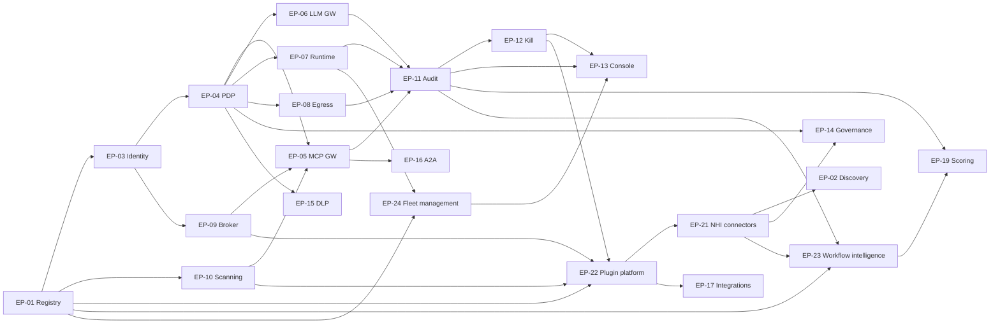

# C. Requirements catalog

[Package index](README.md) · Previous: [B. Discovery](b-discovery-questions.md) · Next: [D. Threat model](d-threat-model.md)

Priority: **P0** MVP must-have · **P1** should-have (Phase 2) · **P2** later (Phase 3+) · **R** research.
Every FR traces to an epic (EP), a threat it mitigates (T, see [D](d-threat-model.md)) and, for P0, an MVP
acceptance check (MVP-n, see [G](g-mvp.md)). Mode: ⛔ prevent, 🔍 detect. The DeepSeek run's MoSCoW tags map
onto these priorities (M → P0, S → P1, C → P2, W → R) and are not repeated.

## 1. Epics

| Epic | Name | Workstream | Phase |
|:--|:--|:--|:--|
| EP-01 | Asset registry and lifecycle | 1 | 1 |
| EP-02 | Discovery and shadow-AI detection | 1 | 1 (config files, two connectors) / 2 |
| EP-03 | Identity, delegation and tokens | 2 | 1 |
| EP-04 | Policy decision point and authoring | 2, 5 | 1 |
| EP-05 | MCP gateway | 3 | 1 |
| EP-06 | LLM gateway | 3 | 1 |
| EP-07 | Local runtime adapter and stdio wrapper | 3 | 1 |
| EP-08 | Egress control | 3 | 1 |
| EP-09 | Credential broker | 8 | 1 |
| EP-10 | Supply-chain scanning and quarantine | 4 | 1 (static) / 2 |
| EP-11 | Telemetry, audit and session reconstruction | 6 | 1 |
| EP-12 | Kill switch and containment | 7 | 1 |
| EP-13 | Admin console (MVP screens) | 12 | 1 |
| EP-14 | Access governance: JIT, requests, reviews, SoD | 2, 10 | 2 |
| EP-15 | DLP and content controls | 5 | 2 |
| EP-16 | A2A gateway | 3 | 1 (observe) / 2 (enforce) |
| EP-17 | Enterprise integrations | 11 | 2 to 3 |
| EP-18 | HA, multi-tenancy, DR, upgrades | 12 | 3 |
| EP-19 | Trust, quality and risk scoring | 9 | 4 |
| EP-20 | Multi-agent oversight (advanced) | 10 | 4 |
| **EP-21** | **NHI connectors and inventory** [new] | 1, 2, 11 | 1 (contract, two read-only connectors) / 2 (cloud and on-prem connectors, lifecycle actions) |
| **EP-22** | **Plugin platform and developer ecosystem** [new] | 11, 12 | 1 (contract, host, Go SDK, harness) / 2 (library, more SDKs and types) |
| **EP-23** | **Workflow intelligence: redundancy and optimization** [new] | 1, 6, 10 | 1 (fingerprint fields only) / 2 (deterministic) / 3 (semantic) |
| **EP-24** | **Agent fleet management: posture, managed configuration, lifecycle change control** [new, 2026-11-09 review] | 1, 3 | 1 (posture for the MVP runtime, self-protection, groups) / 2 (managed-config generation, change control, ownership transfer) |

## 2. User stories (representative, one or more per epic)

| ID | As a… | I want… | So that… | Epic |
|:--|:--|:--|:--|:--|
| US-01 | agent developer | to register my agent with its MCP servers and purpose via API or UI | it can get an identity and run | EP-01 |
| US-02 | security architect | to see every MCP server configured on managed machines, registered or not | I can find shadow tools | EP-02 |
| US-03 | IAM engineer | an agent acting for a user to never exceed that user's permissions | agents can't launder privilege | EP-03 |
| US-04 | agent developer | a denied call to tell me which policy denied it and how to request access | I can fix it without a ticket to security | EP-04 |
| US-05 | security architect | to allow `github.create_issue` but deny `github.delete_repo` for an agent | tool access is least-privilege | EP-05 |
| US-06 | platform engineer | a per-agent daily token budget that blocks when exceeded | a runaway loop can't burn the budget | EP-06 |
| US-07 | security architect | Claude Code's `Bash` tool calls checked against policy before they run | local actions are governed too | EP-07 |
| US-08 | SOC analyst | a managed agent's connection to an unapproved host refused and logged | exfiltration via direct HTTP fails | EP-08 |
| US-09 | agent developer | my agent to call GitHub without ever seeing the token | a prompt injection can't steal it | EP-09 |
| US-10 | AppSec engineer | a new MCP server held in quarantine until its scan passes or I approve an exemption | unvetted code never runs | EP-10 |
| US-11 | auditor | to reconstruct a session: who started it, every model call, tool call, decision and credential use | I can answer "who did what" | EP-11 |
| US-12 | incident responder | to suspend an agent and see each enforcement point confirm it | I know it actually stopped | EP-12 |
| US-13 | security architect | a coverage panel showing which paths are enforced, observed or unmonitored | I don't overstate protection | EP-13 |
| US-14 | resource owner | to approve a 4-hour JIT grant for an agent to write to prod | standing privilege stays near zero | EP-14 |
| US-15 | DPO | card numbers and API keys blocked from leaving in tool arguments | regulated data doesn't leak | EP-15 |
| US-16 | platform engineer | A2A calls to carry the delegated identity and be authorized per task | agent-to-agent hops are governed | EP-16 |
| US-17 | SOC analyst | ASCC events in our SIEM in a documented schema | detection rules live where we work | EP-17 |
| **US-18** | IAM engineer | one inventory of service accounts, roles, keys and app registrations across our clouds, vault, source host and directory, each with owner, last use and credential age | I can find the ownerless and stale ones without logging into six consoles | EP-21 |
| **US-19** | IAM engineer | to disable a stale service account from ASCC, through the platform's own API, after a second person approves | the inventory is something I act on, not just read | EP-21 |
| **US-20** | security architect | to see which agents and workflows use a given NHI | a leaked key's blast radius includes the automations behind it | EP-21 |
| **US-21** | plugin developer (outside the core team) | to scaffold a connector from a template, run it against a local harness with fixtures, pass the conformance suite and submit it | I can ship a plugin without a meeting with the core team | EP-22 |
| **US-22** | AppSec engineer | a plugin install to show me the capabilities it requests and its scan results before I approve | plugins get least privilege like everything else | EP-22 |
| **US-23** | platform engineer | a crashing or slow plugin to never affect the gateway or the PDP | extension never costs enforcement | EP-22 |
| **US-24** | automation owner | to be told that two n8n workflows and one agent all summarise the same tickets from the same source to the same channel | I can merge them and own one thing | EP-23 |
| **US-25** | security architect | each consolidation proposal to list the NHIs, permissions and destinations that disappear if it's accepted | I can see redundancy as attack surface, not just cost | EP-23 |
| **US-26** | compliance lead | the NHI inventory included in access-review campaigns and evidence packs | non-human access gets the same review as human access | EP-21, EP-14 |
| **US-27** | IAM engineer | AI agents listed in the same inventory as service accounts, keys and app registrations, with the same owner, last-use and credential-age columns | "non-human identity" means one population with one review, not two tools | EP-21 |
| **US-28** | AI platform engineer | to know, per machine, whether the agent runtime is set up so the policy hook can't be switched off, and to hand my device-management team the settings file that makes it so | "enforced" on the dashboard is a fact about the machine, not a hope | EP-24 |
| **US-29** | security architect | an approved agent that gains a tool, an MCP server, a model or an egress host to go back to review for that change | approval covers what the agent is now, not what it was when I signed | EP-24 |
| **US-30** | agent owner leaving the team | my agents and NHIs handed to a named person who accepts them, with a deadline | nothing I owned becomes an orphan with live credentials | EP-24, EP-21 |
| **US-31** | AI platform engineer | to put 200 agents under policy by assigning each to a profile | onboarding an agent is a registry entry, not a policy change | EP-24, EP-04 |
| **US-32** | security architect | agents built on vendor platforms (assistant builders, cloud agent services) listed next to the ones we run ourselves, marked as not enforced | the fleet list includes the agents I can't put a hook in front of | EP-21 |

## 3. Functional requirements

### 3.1 Registry and discovery (EP-01, EP-02)

| ID | Requirement | Pri | Acceptance criteria | Threats | MVP |
|:--|:--|:--|:--|:--|:--|
| FR-REG-01 | Store assets of types: agent, agent_instance, model, provider, mcp_server, mcp_tool, a2a_endpoint, skill, cli_tool, prompt, workflow, credential_ref, dataset, **nhi_account, connector, plugin** | P0 | CRUD via API for each type; schema validation rejects unknown fields; JSON Schema published | T-12 | MVP-1 |
| FR-REG-02 | Every asset has an owner and backup owner who are distinct, active IdP principals; NHIs discovered by connectors may be `ownerless` until assigned, and `ownerless` is a finding | P0 | Create without both is rejected (manual assets); owner deactivated in IdP → asset flagged `orphaned` within 24 h; discovered NHI without owner → `ownerless` finding | T-12, T-26 | MVP-1, MVP-12 |
| FR-REG-03 | Lifecycle states `discovered → pending_review → approved → restricted → quarantined → retired`; only `approved` and `restricted` assets can be invoked (agents, tools, servers, **plugins**) | P0 ⛔ | PEPs and the plugin host deny invocation of assets in other states; state change is audited with actor and reason | T-05, T-24 | MVP-4, MVP-11 |
| FR-REG-04 | Record source, version, content digest (SHA-256) and, where available, signature and SBOM reference | P0 | Digest mismatch between registry and running artifact → deny (MCP tool-description pin, plugin binary) or alert (others) | T-05, T-06 | MVP-4 |
| FR-REG-05 | Relationship graph: agent → tool → credential_ref → resource, agent → agent (may_delegate_to), principal → agent (owns, may_invoke), **agent/workflow → nhi_account (uses_nhi), connector → nhi_account (observed_by)** | P0 | Graph query API returns blast radius (all reachable tools, credentials, NHIs, resources) for an agent, and all agents/workflows for an NHI | T-08, T-26 | MVP-6, MVP-12 |
| FR-REG-06 | Config-file discovery of local MCP servers and agent configs on managed machines, **delivered as a connector plugin** (FR-PLG-15) | P0 🔍 | Collector reads known config locations, reports servers not in registry as `discovered`; list of locations is versioned | T-12 | MVP-8, MVP-11 |
| FR-REG-07 | Drift detection: declared vs observed tools, destinations, versions, **NHI permissions** | P1 🔍 | Alert when an MCP server's `tools/list` changes from the pinned set, or a connector reports a permission change on an NHI | T-06 | |
| FR-REG-08 | Discovery connectors for AI assets (GitHub/GitLab orgs, cloud AI services, IdP app registrations, egress logs) are connector plugins per [§3.11](#311-nhi-connectors-ep-21); each reports coverage | P1 🔍 | Each connector reports coverage (scopes scanned, last run, errors) | T-12 | |
| FR-REG-09 | Decommissioning: retiring an asset revokes its credentials, removes grants, **requests disable of NHIs it alone used (via connector, with approval)**, and keeps history | P1 | Retired asset has no active grants or credentials; audit history intact | T-12 | |
| FR-REG-10 | Owner attestations (periodic "still needed, purpose unchanged") for agents **and NHIs** | P1 | Unattested after N days → `restricted` (agents) / `attestation_overdue` finding (NHIs) | T-12 | |
| FR-REG-11 | Discovery results carry a confidence and a coverage indicator [DS] | P0 | Every `discovered` asset has `confidence ∈ {high, medium, low}` and the connector or collector that found it | T-12 | MVP-8 |
| **FR-REG-12** | **Ownership transfer.** An `orphaned` asset or NHI (FR-REG-02) notifies its backup owner, who becomes owner on acceptance; a transfer names the new owner, who must accept; unresolved after N days (default 14) → agent `restricted`, NHI gets a `disable` proposal | P1 | Transfer without the new owner's acceptance stays pending; the deadline fires in a test with a deactivated owner; every step audited | T-12 | |
| **FR-REG-13** | **Change control on approved agents.** A material change (model, tool or MCP server added, egress host added, new NHI used, risk tier up, definition digest changed) puts the *change* in `pending_review`; the agent keeps running on its last approved definition until the change is approved, and the new capability is denied meanwhile | P1 ⛔ | An approved agent with a new MCP server in its manifest can't call it before approval; removing a capability needs no review | T-05, T-06 | |
| **FR-REG-14** | **Expiry.** An agent or grant may carry `expires_at` (pilots, contractors, experiments); past it the agent is `restricted` and its owner is asked to renew or retire | P1 ⛔ | Expired agent denied at the next call; renewal is an audited owner action | T-12 | |
| **FR-REG-15** | **Declarative registration and bulk operations.** Agents and NHIs can be registered from manifest files kept in Git and validated in CI by the `ascc` CLI; import and export of the whole registry in the same format. The public MVP's `ascc.registry.json` is this format | P1 (P0 for the file format) | A manifest that fails schema validation fails CI with the field named; export then import is lossless | T-12 | |

### 3.2 Identity, delegation and access governance (EP-03, EP-14)

| ID | Requirement | Pri | Acceptance criteria | Threats | MVP |
|:--|:--|:--|:--|:--|:--|
| FR-IAM-01 | Human SSO via OIDC to console and API | P0 | Login through Keycloak in dev; no local passwords | T-01 | MVP-1 |
| FR-IAM-02 | Each agent *instance* gets an identity bound to its registry record and runtime (instance keypair or workload identity) | P0 | Token presented by a different instance key is rejected | T-01, T-03 | MVP-5 |
| FR-IAM-03 | Delegation via token exchange producing an ASCC transaction token carrying subject, actor chain, task ID, purpose, scope ceiling and depth | P0 ⛔ | Token schema per [F §3](f-data-contracts.md#3-identity-and-delegation-token); TTL ≤ 15 min; signature verified at every PEP | T-02, T-03 | MVP-5 |
| FR-IAM-04 | Intersection rule: effective permission = initiator ∩ agent grant ∩ task scope ∩ policy; never union | P0 ⛔ | Test: user lacking `repo:write` → agent with `repo:write` grant still denied on that user's task | T-02 | MVP-5 |
| FR-IAM-05 | Service grants (agent acts on its own authority) are explicit, owner-approved, and labelled in every decision log | P0 | Decision log field `authority = service_grant` present; cannot be created by the agent's own owner alone (P1 SoD) | T-02 | |
| FR-IAM-06 | Maximum delegation depth per policy (default 3) | P0 ⛔ | Depth 4 exchange refused | T-17 | MVP-5 |
| FR-IAM-07 | Revocation of an agent identity invalidates outstanding tokens within the propagation SLO | P0 ⛔ | Revocation list pushed to PEPs; token with revoked `jti`/agent denied | T-03 | MVP-7 |
| FR-IAM-08 | JIT grants with expiry, access requests, approval workflow | P1 ⛔ | Expired grant denied at the next call | T-02 | |
| FR-IAM-09 | Segregation of duties: requester ≠ approver; high-risk grants, **plugin installs and NHI lifecycle actions** need two approvers from different roles | P1 ⛔ (P0 for plugin installs: two approvers via API) | Self-approval refused by API, not just UI | T-15, T-24 | MVP-11 |
| FR-IAM-10 | Access reviews: periodic certification of agent grants **and NHIs** by owners; uncertified grants auto-expire, uncertified NHIs get a `disable` proposal | P1 | Campaign report; revoked grants listed; NHI section present | T-12 | |
| FR-IAM-11 | SCIM inbound for owner/group sync; IdP group → ASCC role mapping | P1 | Deprovisioned user's agents and NHIs flagged orphaned | T-12 | |
| FR-IAM-12 | Break-glass accounts: sealed, two-person, time-boxed, loudly alerted | P1 | Use triggers alert to all security admins and auto-expires | T-15 | |
| FR-IAM-13 | Workload identity via SPIFFE/SPIRE for server-side and Kubernetes agents, feeding the same transaction-token exchange [DS, pulled forward] | **P1** | SVID-bound agent instance identity in Kubernetes; exchange accepts an SVID as instance proof | T-01 | |

### 3.3 Policy (EP-04)

| ID | Requirement | Pri | Acceptance criteria | Threats | MVP |
|:--|:--|:--|:--|:--|:--|
| FR-POL-01 | Single PDP API answering `is_authorized(principal, action, resource, context)` for all PEPs | P0 | All MVP PEPs call the same API; decision includes `decision`, `policy_ids`, `reasons`, `obligations` | all | MVP-2 |
| FR-POL-02 | Default deny; explicit `forbid` overrides any `permit` | P0 ⛔ | Unit tests in policy CI | T-02 | MVP-2 |
| FR-POL-03 | Policies are versioned, schema-validated at write time, stored in Git-compatible form, and every decision records the policy-set version | P0 | Invalid policy rejected with line/column; decision log has `policy_version` | T-14 | MVP-2 |
| FR-POL-04 | Obligations on allow: `require_approval`, `redact(fields)`, `inject_credential(ref)`, `log_content`, `rate_limit(key)` | P0 (inject, log), P1 (others) | PEP that can't satisfy an obligation must deny | T-07 | MVP-3 |
| FR-POL-05 | Explain API: human-readable reason and the minimal grant that would allow | P0 | "Why denied" shown in UI and returned in deny response | — | MVP-2 |
| FR-POL-06 | Policy simulation: replay N days of recorded decisions against a draft policy set and diff | P1 | Report of decisions that would flip | T-14 | |
| FR-POL-07 | Policy test suites run in CI on every change | P1 | Merge blocked on failing policy tests | T-14 | |
| FR-POL-08 | Distributed policy cache in PEPs with versioned bundles, max staleness bound, and revocation fast-path | P0 | PEP refuses to serve tier 2/3 decisions from a bundle older than `max_staleness` | T-14 | MVP-7 |
| FR-POL-09 | Plugin-supplied data (findings, NHI attributes, workflow findings) enters policy only as entity attributes or context; **no plugin output can be a `permit` condition on tier 2/3 actions** | P0 ⛔ | Policy linter rejects permits conditioned solely on plugin-sourced attributes for tier 2/3 (extends ADR-14) | T-24, T-25 | MVP-11 |
| FR-POL-10 | Policy packs (Cedar policies + schema fragment + tests) installable as plugins | P1 | Pack validates against the current schema; its tests run before publish | T-14 | |
| **FR-POL-11** | **Agent groups and profiles.** Agents belong to groups (team, environment, risk tier, role profile such as `ci` or `read-only-coder`) that are Cedar parents of the agent entity; policies target groups, and a profile is a group with a shipped policy set | P0 (groups) / P1 (shipped profiles) | A policy on a group applies to every member and to no other agent; moving an agent between groups is an audited registry change that takes effect at the next bundle | T-02 | MVP-2 |

### 3.4 Gateways and runtime enforcement (EP-05 to EP-08, EP-16)

| ID | Requirement | Pri | Acceptance criteria | Threats | MVP |
|:--|:--|:--|:--|:--|:--|
| FR-GW-01 | MCP gateway proxies Streamable HTTP transport, preserving session semantics and streaming; **acts as an OAuth 2.1 resource server to clients and publishes RFC 9728 protected-resource metadata** [DS] **[V]** | P0 | Conformance with the target MCP spec version for proxied flows **[V]**; client without a valid bearer gets 401 with resource metadata | T-01 | MVP-2 |
| FR-GW-02 | `tools/list` responses filtered to the tools the caller may invoke | P0 ⛔ | Unpermitted tools absent from the list returned to the client | T-04 | MVP-2 |
| FR-GW-03 | Every `tools/call` authorized before forwarding, with argument constraints (e.g. path prefix, repo allowlist, URL host) | P0 ⛔ | Unauthorized call returns a JSON-RPC error and never reaches the server | T-02, T-04 | MVP-2 |
| FR-GW-04 | Tool description and schema pinning: digest of each tool's description/schema stored at approval; mismatch → tool hidden and alert | P0 ⛔ | Changed description ("rug pull") makes the tool unavailable until re-approved | T-06 | MVP-4 |
| FR-GW-05 | Tool results tagged as untrusted content in the event stream; optional result inspection | P0 (tag) / P1 (inspect) 🔍 | Result inspection never the sole control on a P0 path | T-04 | |
| FR-GW-06 | LLM gateway: authN, model allowlist, per-agent/per-task token and cost budgets, metering; Anthropic Messages and OpenAI-compatible adapters | P0 ⛔ | Over-budget request returns 429 with reason; token counts from provider response recorded; both adapters pass the same conformance scenarios | T-10 | MVP-3 |
| FR-GW-07 | LLM gateway: provider routing and fallback | P1 | Fallback only to providers allowed for the request's data classification | T-09 | |
| FR-GW-08 | Correlation: every request carries or receives `trace_id`, `session_id`, `task_id`; W3C trace context propagated | P0 | Session view shows one connected trace across LLM and MCP calls | — | MVP-6 |
| FR-GW-09 | A2A: registry entries and **observe-only proxying** (Agent Card fetched and recorded, task events logged, no enforcement) in MVP [DS]; Agent Card validation, task-level authz and delegation-token propagation in Phase 2 | P0 🔍 (observe) / P1 ⛔ (enforce) | MVP: A2A endpoint shows as `observed` in coverage with events; P1: **[V]** against current A2A spec | T-17 | MVP-8 |
| FR-RT-01 | Local runtime adapter for one CLI agent: pre-tool-use hook calls PDP; deny blocks the tool | P0 ⛔ | Denied `Bash` command not executed; decision logged | T-11 | MVP-2 |
| FR-RT-02 | stdio MCP wrapper: client config launches `ascc-mcp-wrap -- <server cmd>`; wrapper enforces like the gateway; **stdio has no protocol-level auth, so trust comes from process identity and the wrapper, and coverage says so** [DS] | P0 ⛔ | Same tests as FR-GW-02/03 pass over stdio; coverage panel labels stdio-without-wrapper as `observed` at best | T-11 | MVP-2 |
| FR-RT-03 | Adapter health heartbeat; missing heartbeat marks the runtime *unmonitored* in coverage | P0 🔍 | Kill the adapter → coverage panel shows unmonitored within 2 heartbeats | T-11 | MVP-8 |
| FR-RT-04 | SDK interceptors (Python, TypeScript) for server-side agent frameworks; **further runtime adapters ship as plugins of type `runtime_adapter`** | P1 ⛔ (SDKs) / P2 (adapter plugins) | | T-11 | |
| **FR-RT-05** | **Runtime posture check.** The adapter reads the runtime's own settings and reports, per host: hook registered from an admin-controlled (managed) location, fail-closed on hook failure, matcher covers every tool, nothing disables hooks, permission-bypass modes off, runtime version in the supported range. An agent instance is `enforced` only while its posture passes; otherwise `observed` with a posture finding naming the failed check | P0 🔍 (MVP runtime) / P1 (others) | Fixture hosts for each failing check produce the matching finding and an `observed` label; posture is re-read at every heartbeat | T-11, T-28 | MVP-8 |
| **FR-RT-06** | **Managed configuration generation.** For each supported runtime ASCC generates the admin-level settings artifact (hook registration, fail-closed flag, MCP server allowlist, denied permission modes) for the enterprise's own device management to deploy. ASCC never pushes settings to a machine | P1 | Generated artifact, applied to a fixture host, passes FR-RT-05; the artifact is versioned and its digest recorded so posture can report "managed config out of date" | T-11 | |
| **FR-RT-07** | **PEP self-protection.** The files a local PEP depends on (policy bundle, registry cache, adapter config, local audit spool, the runtime's hook settings) and the PEP's own state-changing commands are not reachable by the agent it governs: policy forbids tool calls that target them, and install guidance puts them where the agent's user can't write | P0 ⛔ (policy rule) / P1 (OS-level guidance per platform) | An agent asked to edit its policy, clear its audit spool, remove its hook or run the adapter's revive command is denied (ABUSE-33) | T-28 | MVP-2 |
| FR-EG-01 | Default-deny egress proxy for managed runtimes; allowlist by host/SNI; per-agent policy from PDP | P0 ⛔ | Connection to non-allowlisted host refused and logged with agent identity | T-07 | MVP-3 |
| FR-EG-02 | Egress logs reconciled with registry to find unregistered AI provider traffic | P1 🔍 | Report of provider API hosts contacted by unregistered identities | T-12 | |

### 3.5 Supply chain (EP-10)

Applies to MCP servers, skills, packages, agent configs **and plugins** (FR-PLG-05).

| ID | Requirement | Pri | Acceptance criteria | Threats | MVP |
|:--|:--|:--|:--|:--|:--|
| FR-SC-01 | Ingest from Git URL, package (npm, PyPI), container image, OCI artifact, or local folder; pin to digest/commit | P0 | Scan record references an immutable digest | T-05 | MVP-4 |
| FR-SC-02 | Static checks: secrets, known-vulnerable deps, unpinned deps, typosquat candidates, unsafe shell patterns, hidden Unicode, instruction-like text in tool descriptions and skills, suspicious URLs, requested permissions, **plugin manifest capability over-requests** | P0 | Each check emits findings with rule ID, severity, file/line evidence | T-05, T-06, T-24 | MVP-4, MVP-11 |
| FR-SC-03 | Gate: asset stays `pending_review` until no open High/Critical findings or an approved exemption | P0 ⛔ | Gateway and plugin host deny a pending asset; approval moves it to `approved` | T-05, T-24 | MVP-4 |
| FR-SC-04 | Exemptions have owner, justification, scope (finding + digest) and expiry; expiry re-opens the gate | P0 | Expired exemption → asset `restricted` | T-05 | |
| FR-SC-05 | Re-scan on new version, on schedule, and when a new advisory matches a dependency | P1 | Advisory feed match triggers scan within 24 h | T-05 | |
| FR-SC-06 | Dynamic sandbox run: exercise tools, record file, process and network behaviour, diff against declared | P1 🔍 | Undeclared network destination → High finding | T-05 | |
| FR-SC-07 | LLM-assisted review as an advisory finding source, never sole gate | P1 🔍 | Findings carry `source = model_review` and can't auto-approve | T-16 | |
| FR-SC-08 | Signed approval attestations (in-toto/Sigstore style) bound to digest; **plugins must be signed to reach the `verified` tier** | P1 (P0 for signature verification on plugin install) | PEP and plugin host verify attestation/signature on load **[V]** | T-05, T-24 | MVP-11 |
| FR-SC-09 | Trust tiers for sources (internal, verified publisher, community, unknown) with per-tier default gates; same tiers used by the plugin library | P1 | | T-05 | |
| FR-SC-10 | Scanners and analyzers can be added as plugins of type `scanner`; findings use the shared schema | P1 | A scanner plugin's findings gate assets exactly like built-in scanners | T-05 | |

### 3.6 DLP and injection defences (EP-15)

| ID | Requirement | Pri | Acceptance criteria | Threats | MVP |
|:--|:--|:--|:--|:--|:--|
| FR-DLP-01 | Deterministic detectors on tool arguments and LLM requests: credential formats, private keys, PAN (Luhn), IBAN | P0 ⛔ | Seeded secrets in tool args blocked; false-positive rate tracked | T-07 | MVP-3 |
| FR-DLP-02 | Classification labels (PII, PHI, financial, payment, confidential, regulated, credentials, source code, IP [DS]) on resources, datasets and credentials drive policy (e.g. `phi` data can't go to a provider without a BAA flag) | P1 ⛔ | | T-09 | |
| FR-DLP-03 | Probabilistic PII/PHI detection on prompts, responses, tool results; redact or flag | P1 🔍/⛔ | Detector precision/recall measured on a labelled set before any blocking mode | T-07 | |
| FR-DLP-04 | Prompt-injection detectors on tool results and retrieved content | P1 🔍 | Advisory only; never authorizes; result tagged `suspected_injection` | T-04 | |
| FR-DLP-05 | Taint-style rule: after a session ingests untrusted content, tier 3 actions require approval | P1 ⛔ | Session flag `untrusted_ingested=true` changes PDP context | T-04 | |
| FR-DLP-06 | Detectors can be added as plugins of type `detector`; a detector plugin's verdict is a signal with the plugin's confidence, never a decision | P1 🔍 | | T-24 | |

### 3.7 Telemetry and audit (EP-11)

| ID | Requirement | Pri | Acceptance criteria | Threats | MVP |
|:--|:--|:--|:--|:--|:--|
| FR-TEL-01 | Canonical event schema for all PEP decisions, lifecycle actions, **connector syncs and plugin actions** | P0 | Schema per [F §4](f-data-contracts.md#4-event-schema); validator in CI | — | MVP-6 |
| FR-TEL-02 | OTel traces with GenAI semantic conventions where they exist, ASCC attributes under `ascc.*` | P0 | Traces viewable in the dev trace UI **[V]** convention status | — | MVP-6 |
| FR-TEL-03 | Audit log is append-only, hash-chained per tenant, with periodic signed checkpoints | P0 ⛔ (tamper-evident) | Verification tool detects modified, deleted, inserted or reordered records | T-13 | MVP-6 |
| FR-TEL-04 | Session reconstruction from audit alone | P0 | Timeline view with identity chain, decisions, credential uses | — | MVP-6 |
| FR-TEL-05 | Content capture off by default; when on, encrypted with a separate key, access-logged | P1 | Reading content creates an audit event | T-09 | |
| FR-TEL-06 | SIEM export (OTLP, syslog/CEF, HTTP JSON); further exporters as `notification`/`export` plugins | P1 | Documented field mapping | — | |
| FR-TEL-07 | Retention policies and legal hold (13 months metadata, 30 days content by default) | P1 | Held records survive retention job | — | |
| FR-TEL-08 | Coverage report: per asset and path, enforced / observed / unmonitored, with reason; **per platform: connected / not connected, with connector freshness** | P0 | Matches the documented bypass list in [E §6](e-architecture.md#6-bypass-routes-and-coverage); a platform with no connector shows `not_connected` | T-11, T-26 | MVP-8, MVP-12 |
| FR-TEL-09 | Dashboards: usage, risk, cost, sessions, anomalies, permissions, violations, lineage, evidence, **NHI hygiene, plugin health, workflow overlap** [DS] | P1 | Grafana dashboards shipped with the Compose stack | — | |

### 3.8 Kill switch (EP-12)

| ID | Requirement | Pri | Acceptance criteria | Threats | MVP |
|:--|:--|:--|:--|:--|:--|
| FR-KS-01 | Actions: deny next action, terminate session, suspend agent, disable tool/server/skill, revoke credential, block provider/model, **disable plugin**, **revoke/disable NHI via connector** | P0 (agent suspend, credential revoke, tool disable, **disable plugin**) / P1 (rest, incl. NHI via connector) ⛔ | Each action has a defined "stopped" meaning per runtime ([E §8](e-architecture.md#8-kill-switch-semantics)) | T-03, T-24 | MVP-7, MVP-11 |
| FR-KS-02 | Kill status per PEP **and per plugin/connector**: requested → propagated → acknowledged; unacknowledged after timeout → `unconfirmed` and escalated | P0 | Status visible in UI and API | — | MVP-7 |
| FR-KS-03 | Operator authZ: role-gated; fleet-wide kill needs two operators | P0 (role) / P1 (two-person) | Unauthorized kill request rejected and audited | T-15 | MVP-7 |
| FR-KS-04 | Reversal is a separate, audited action with its own approval | P0 | Resume requires a fresh decision; no auto-resume | — | |
| FR-KS-05 | SOAR/webhook trigger with signed requests | P1 | | — | |
| FR-KS-06 | Network isolation via egress policy (agent's egress set to empty) | P1 ⛔ | | — | |
| FR-KS-07 | Incident playbooks, case-management links, notifications and a post-incident review record per containment [DS] | P1 | Containment record links to a case and a review artifact | — | |
| **FR-KS-08** | **Containment shows the credentials left standing.** Suspending or retiring an agent lists every NHI it uses (`uses_nhi`), marks the ones only it uses, and says for each whether ASCC can revoke it (brokered, or a connector with a write scope) or a human must | P0 (list) / P1 (queued revoke proposals) | Containment record for the demo agent lists its GitHub App NHI with `revocable_by: broker`; an NHI with no write connector shows `manual` | T-03, T-08 | MVP-7 |

### 3.9 Secrets (EP-09)

| ID | Requirement | Pri | Acceptance criteria | Threats | MVP |
|:--|:--|:--|:--|:--|:--|
| FR-SEC-01 | Registry stores credential *references* only; values never enter ASCC DB, logs, traces **or plugins** | P0 ⛔ | Secret-scanning of DB dumps and logs in CI finds none; plugin host never passes a secret value to a plugin | T-07, T-24 | MVP-5, MVP-11 |
| FR-SEC-02 | Gateway-side credential injection: the upstream MCP/API call gets the secret; the agent never does | P0 ⛔ | Agent process memory/env contains no upstream token (test by inspection) | T-07 | MVP-5 |
| FR-SEC-03 | When an agent must hold a credential, issue it dynamic, short-lived, audience-bound | P1 | TTL ≤ 1 h; revocable | T-07 | |
| FR-SEC-04 | Leak detection: canary tokens and scanning of egress/tool args for brokered credential prefixes | P1 🔍 | | T-07 | |
| FR-SEC-05 | Signing keys (audit checkpoints, transaction tokens, bundles) live in KMS/vault transit; **in production the customer owns the root keys in their KMS/HSM and ASCC holds no tenant root key** [DS]; rotation runbook | P0 | Key rotation tested without breaking verification of old records; production profile refuses to start with dev keys | T-13 | |
| FR-SEC-06 | Connector and plugin credentials are brokered too: a connector's platform credential is a `credential_ref` used by the plugin host on the plugin's behalf, scoped read-only unless a write scope is separately approved | P0 ⛔ | Connector process environment contains no platform secret; write-scope connectors are a distinct asset with their own approval | T-23 | MVP-12 |

### 3.10 Trust, oversight, integrations, admin (EP-13, EP-17 to EP-20)

| ID | Requirement | Pri | Acceptance criteria | Threats | MVP |
|:--|:--|:--|:--|:--|:--|
| FR-TRS-01 | Inherent risk tier (1 to 3) computed by rule from declared capabilities and data access | P0 | Rule table versioned; tier shown with reasons | — | |
| FR-TRS-02 | Separate scores: security trust, operational quality, residual risk, compliance posture, **NHI hygiene**, each with evidence, confidence, freshness, version | P2 | No score is an input that can flip a `forbid` | T-16 | |
| FR-TRS-03 | Scores never grant access; manual overrides audited; appeals workflow | P2 ⛔ | Policy lint rejects score-only permits on tier 3 actions | T-16 | |
| FR-MAO-01 | Per-task budgets (tokens, cost, tool calls, wall time) enforced across the delegation tree | P0 ⛔ | Child agents draw from parent's budget | T-10, T-17 | MVP-3 |
| FR-MAO-02 | Requester ≠ executor ≠ approver for tier 3 actions; identities compared across the actor chain | P1 ⛔ | Agent can't approve its own (or its ancestor's) request | T-15 | |
| FR-MAO-03 | Loop and cycle detection in delegation (same agent re-entering the chain) | P1 ⛔ | Cycle → deny | T-17 | |
| FR-MAO-04 | Collusion / circular validation detection | R 🔍 | | T-16 | |
| FR-INT-01 | IdP: OIDC (Keycloak dev; Entra ID, Okta) | P0 (Keycloak) / P1 | | — | MVP-1 |
| FR-INT-02 | Secrets: OpenBao/Vault broker backend; cloud secret managers and PAM as connector plugins | P0 (OpenBao) / P1 | | — | MVP-5 |
| FR-INT-03 | SIEM, ITSM (ServiceNow, Jira), chat (Slack, Teams), SCM (GitHub, GitLab) as plugins of type `notification` / `connector`; default SIEM path is OTLP + HTTP/CEF [DS] | P1 | Each integration documents required scopes **[V]** API | — | |
| FR-ADM-01 | MVP console: catalog, asset detail, findings, session timeline, kill panel, coverage panel, **minimal approval inbox and scan queue** [DS], **NHI inventory list**, **installed plugins** | P0 | Usable at 1280 px and on a phone (kill panel, approval inbox) | — | MVP-1..12 |
| FR-ADM-02 | API-first: every console action is a documented API call | P0 | OpenAPI 3.1 spec covers 100 % of console actions | — | |
| FR-ADM-03 | Policy workbench, identity graph view, **connector health, plugin library browser, workflow map, optimization inbox** | P1 | | — | |
| FR-ADM-04 | Multi-tenant org / workspace / environment scopes with delegated admin | P2 | | T-18 | |
| FR-ADM-05 | Console panels can be contributed by plugins of type `console_panel`, rendered in a sandboxed frame with a scoped API token | P1 | A panel plugin can't read outside its declared API scopes | T-25 | |

### 3.11 NHI connectors (EP-21)

**Scope [A-13]:** the inventory holds every NHI a connector can see; `ai_linked` is an attribute derived from
the relationship graph. Connectors are plugins (§3.12); this section is what a connector must deliver and what
ASCC does with it. New threats referenced here are defined in [D](d-threat-model.md): **T-23** compromised or
misused connector credential, **T-26** the aggregated NHI inventory as an attacker's target map.

| ID | Requirement | Pri | Acceptance criteria | Threats | MVP |
|:--|:--|:--|:--|:--|:--|
| FR-CON-01 | Connector contract: a plugin of type `connector` implements `Describe` (platform, capabilities, scopes it needs, rate limits), `Discover` (AI assets and NHIs, paginated, incremental since a cursor), `Enrich` (permissions summary, last used, credential age, rotation state), `Act` (optional lifecycle actions, each declared), `Health` | P0 | Conformance suite passes against a mock platform; a connector that omits `Act` is accepted as read-only | T-23 | MVP-12 |
| FR-CON-02 | `nhi_account` registry type with kinds: `agent_identity` (FR-CON-15), `service_account`, `iam_user`, `iam_role`, `service_principal`, `managed_identity`, `api_key`, `oauth_app`, `bot_token`, `deploy_key`, `ci_token`, `db_user`, `certificate`, `vault_role`, `k8s_service_account`, `ad_service_account`, `workflow_credential`; fields per [F §2.5](f-data-contracts.md#25-nhi-connector-plugin-and-workflow-entities) | P0 | Schema published; unknown kind rejected; each record names the connector(s) that observed it | T-26 | MVP-12 |
| FR-CON-03 | Cross-source reconciliation: the same NHI seen by several connectors merges into one record by deterministic keys (ARN, client ID, object ID, vault path + role, key fingerprint) with a confidence; conflicts are shown, not silently resolved | P0 (exact-key merge) / P1 (heuristic merge, conflict UI) | OpenBao AppRole and the GitHub App it authenticates appear as one NHI with two sources | T-26 | MVP-12 |
| FR-CON-04 | AI linkage: `uses_nhi` edges from agent/workflow to NHI derived from credential_refs, broker usage, gateway authentication and config discovery; NHIs with no edge are flagged `unlinked` for review (shadow AI or retirement candidates) | P0 (registry and broker-derived) / P1 (telemetry-inferred) 🔍 | Blast-radius query for an NHI returns every agent and workflow using it; `unlinked` filter works | T-08, T-26 | MVP-12 |
| FR-CON-05 | MVP connectors, read-only: **OpenBao/Vault** (KV paths as credential_refs, AppRoles, tokens and leases, transit keys) and **GitHub** (GitHub Apps and installations with permissions, deploy keys, organization PAT policy, Actions secret *names*) **[V]** API scopes for each | P0 🔍 | Both connectors pass conformance; inventory shows NHIs from both with owner or `ownerless`; coverage shows scopes scanned | T-23 | MVP-12 |
| FR-CON-06 | Hygiene findings on NHIs, in the shared finding schema: `ownerless`, `stale` (unused > N days, default 90), `over_privileged` (admin-class permission with low or no use), `credential_age_exceeded`, `no_rotation`, `shared_widely` (used by > N workflows), `attestation_overdue` | P0 (`ownerless`) / P1 (rest) 🔍 | Findings carry evidence (connector, timestamps, permission list); thresholds configurable per tenant | T-26 | MVP-12 |
| FR-CON-07 | Coverage per connector: scopes granted vs needed, objects scanned, last successful sync, errors, freshness; a platform listed in the tenant's estate with no connector shows `not_connected` in the coverage panel | P0 🔍 | Coverage panel row per connector and per declared platform | T-26 | MVP-12 |
| FR-CON-08 | Lifecycle actions through the connector: `disable`, `enable`, `rotate`, `revoke`, `set_owner_tag`, `delete` (P2); each needs two approvers (FR-IAM-09), supports dry-run, is rate-limited (per connector per hour), audited with before/after state, and reversible where the platform allows | P1 ⛔ | Disable of a stale service account executes in the platform after approval; mass action above the rate limit is refused | T-23 | |
| FR-CON-09 | Connector credentials are brokered (FR-SEC-06), least privilege, read scopes separate from write scopes; the connector runs under the plugin host with egress limited to the platform's API hosts | P0 ⛔ | Connector process has no secret in env; egress to any other host refused | T-23 | MVP-12 |
| FR-CON-10 | Phase 2 connector set: AWS IAM (users, roles, access keys, OIDC providers), Entra ID / Azure (service principals, app registrations, managed identities), GCP (service accounts and keys), Okta (API tokens, OAuth apps), Kubernetes (service accounts, tokens), Active Directory / LDAP (service accounts, gMSAs), GitHub Actions and GitLab CI secrets, **n8n** (credentials and workflows). Phase 3: SailPoint, CyberArk, Snowflake, Databricks, Slack apps, ServiceNow, Salesforce. Each documents required API scopes **[V]** before build | P1 / P2 🔍 | Connector listed in the library with scopes and coverage statement | T-23 | |
| FR-CON-11 | Sync: incremental on a schedule (default hourly), event-driven where the platform offers webhooks or audit streams, full reconcile daily; permission or credential changes emit drift events (FR-REG-07) | P0 (scheduled) / P1 (event-driven) | Missed sync beyond 2 intervals → connector `stale` in coverage | T-26 | MVP-12 |
| FR-CON-12 | Kill-switch integration: `revoke_nhi` and `disable_nhi` containment actions route through the owning connector and are tracked like PEP acks (FR-KS-02) | P1 ⛔ | Containment record shows connector ack or `unconfirmed` | T-03 | |
| FR-CON-13 | NHI export and review: inventory export (CSV, JSON), inclusion in access-review campaigns (FR-IAM-10) and evidence packs | P1 | Campaign includes NHIs with owner certification; export is schema-versioned | — | |
| FR-CON-14 | Connectors can also discover AI assets (agents, MCP servers, models in use, automations) on their platform and register them as `discovered` with confidence (FR-REG-11); this is how FR-REG-08 is delivered | P1 🔍 | GitHub connector lists repositories containing MCP server manifests or agent configs as `discovered` | T-12 | |
| **FR-CON-15** | **One non-human population.** The NHI inventory view and API return agents and agent instances alongside `nhi_account` records, with the same governance columns (owner, status, last active, credential age, findings, coverage). New kind `agent_identity` for an identity a platform issues to an agent (directory or cloud agent-identity objects **[V]** product names and APIs), reconciled to the ASCC agent it belongs to | P0 (unified view) / P1 (`agent_identity` via connectors) | The inventory list filtered to "all non-human" shows the demo agent, its instance and its GitHub App; access reviews and exports (FR-CON-13) cover agents with no extra step | T-12, T-26 | MVP-12 |
| **FR-CON-16** | **Vendor-hosted agents.** Connectors for agent-building platforms (SaaS assistant builders, cloud agent services, workflow tools with agent nodes) register the agents they find as `agent` assets with `hosting: vendor_hosted`, their declared tools, connections and owner; coverage is `observed` at best and says why. Each platform's API is **[V]** before build | P1 🔍 | A fixture platform with three agents yields three `discovered` agents with owner or `ownerless`; none is ever labelled `enforced` | T-12 | |
| **FR-CON-17** | **Hygiene rules map to the OWASP NHI Top 10** **[V]** numbering. Adds findings `exposed_secret` (a scanner or DLP hit ties a leaked credential to its NHI), `cross_environment` (one NHI used in prod and non-prod), `human_use` (interactive sign-in on an NHI, where the platform reports it) | P1 🔍 (P2 for `human_use`) | Every hygiene rule carries its Top 10 item in `references`; a scan finding for a hardcoded key links to the NHI with the same fingerprint | T-07, T-26 | |
| **FR-CON-18** | **Inventory documents in and out.** ASCC imports and exports the Agent Security Suite inventory document (schema v0.1): identities, credentials by fingerprint, grants, findings. Import is the connector of last resort for a platform with no plugin, and the only NHI source in the public MVP | P0 (file import and export) / P1 (scheduled import from a path) | Import of a fixture document creates `nhi_account` records with `found_by: import`; re-import is idempotent by identity `id`; export validates against the schema | T-26 | MVP-12 |

### 3.12 Plugin platform (EP-22)

**Scope [A-14]:** out-of-process plugins under a plugin host; Go SDK in MVP; connectors are the first plugin
type and the two MVP connectors plus the config collector are built on it, so the contract is proven on real
work before the library opens. New threats referenced here are defined in [D](d-threat-model.md): **T-24**
malicious or vulnerable plugin, **T-25** plugin host and plugin API as a control-plane attack surface.

| ID | Requirement | Pri | Acceptance criteria | Threats | MVP |
|:--|:--|:--|:--|:--|:--|
| FR-PLG-01 | Plugin contract `v1alpha1`: versioned gRPC services (`Plugin.Describe`, `Plugin.Health`, plus one service per plugin type), protobuf with never-reused field tags, semantic versioning, compatibility negotiated at start | P0 | Contract published in the repo with generated docs; a plugin built against `v1alpha1` runs on every host of the same minor | T-25 | MVP-11 |
| FR-PLG-02 | Plugin types: `connector` (P0), `scanner`, `detector`, `notification`, `console_panel`, `policy_pack` (P1), `runtime_adapter`, `report_template` (P2); the type system itself and the connector type are P0 | P0 (type system, connector) / P1 / P2 | Each type has a proto service, a template and conformance tests before it is listed as supported | — | MVP-11 |
| FR-PLG-03 | Manifest `plugin.yaml`: `id`, `version`, `type`, `publisher`, `capabilities` (API scopes, event subscriptions, network hosts, credential_ref kinds it may use), `compat` (contract range), `signature`, `sbom_ref`, `licence`, `docs_url`, `security_contact`; schema-validated at install | P0 | Install with an invalid or incomplete manifest is rejected with the field named | T-24 | MVP-11 |
| FR-PLG-04 | Plugin host runs every plugin out of process (container in Compose/Kubernetes, process on a laptop adapter), issues a **capability-scoped token** containing only the approved scopes, enforces a per-plugin egress allowlist, CPU/memory/time limits, health heartbeat, restart with backoff, and crash isolation | P0 ⛔ | A plugin calling an API outside its scopes gets 403 and an event; a crashing plugin is restarted and never affects gateway or PDP latency (FAIL-12) | T-24, T-25 | MVP-11 |
| FR-PLG-05 | Install gate: a plugin is a registry asset; install → static scan (FR-SC-02 incl. manifest over-request check) → signature check → two-person approval showing requested capabilities and scan results → `approved`; unsigned, failed or unapproved → `quarantined`; **upgrades are re-gated; any capability increase needs re-approval** | P0 ⛔ | Quarantined plugin cannot start; upgrade that adds a scope stops at approval | T-24 | MVP-11 |
| FR-PLG-06 | Plugins cannot receive secret values (the host performs brokered calls on their behalf where a scope allows), cannot write to the audit log directly (the host emits events with `plugin_id`), and cannot return authorization decisions (FR-POL-09) | P0 ⛔ | Conformance test: plugin requesting a raw secret is refused; events from a plugin carry its identity | T-24, T-25 | MVP-11 |
| FR-PLG-07 | `disable_plugin` containment action: stops the process, revokes its token, marks coverage it provided `stale`, and is acknowledged like a PEP kill | P0 ⛔ | Disabled connector's NHIs show stale freshness; action reversible via FR-KS-04 | T-24 | MVP-11 |
| FR-PLG-08 | SDKs generated from the proto with helpers (pagination cursors, retries, rate limits, finding and NHI schema builders, structured logging): Go (P0), Python and TypeScript (P1) | P0 / P1 | Each SDK ships the same example connector; conformance passes in all three | — | MVP-11 |
| FR-PLG-09 | Developer experience: template repository per plugin type; `ascc plugin init \| dev \| test \| package \| submit` CLI; local harness (mock control plane with fixtures, record/replay of platform API traffic); conformance suite; reference docs generated from the contract; tutorial "your first connector in an afternoon" | P0 (Go template, harness, conformance, generated reference) / P1 (CLI `submit`, tutorials, docs site) | A developer outside the core team builds a working connector from the template in ≤ 2 days, measured at the Phase 1 exit (A §9) | — | MVP-11 |
| FR-PLG-10 | Plugin library: a public index (repository plus static site) listing each plugin's manifest, signature status, scan summary, trust tier (`core`, `verified`, `community`), contract compatibility and install count; the console's library browser installs from the index through the gate (FR-PLG-05) | P1 | Library page per plugin; install from the console reaches `pending_review` with the index metadata attached | T-24 | |
| FR-PLG-11 | Submission pipeline: pull request to the index → automated scan, conformance run, licence check → listing as `community`; core-team review → `verified`; takedown procedure; vulnerability-disclosure policy and security contact published | P1 | A submission failing conformance never lists; takedown removes it from the index and flags installed copies `restricted` | T-24 | |
| FR-PLG-12 | Contract stability: deprecations announced two minor versions ahead; the host runs the current and previous minor; breaking changes only in a new major; each plugin reports its contract version in `Describe` and in every event | P0 (policy) | Compatibility matrix published with each release; a plugin on a deprecated minor shows a warning in the console | — | |
| FR-PLG-13 | Developer programme and promotion: "Build a plugin" page on the docs site and the org landing page, featured plugins, contributor credits, a contract changelog, a public roadmap of wanted connectors; **incentives (bounties, revenue share, partner badges) are a decision for Mike [Q]** and none is assumed | P1 | Pages exist and link to the template, harness and submission guide; the wanted-connectors list is maintained | — | |
| FR-PLG-14 | Plugin telemetry: every plugin action is an event with `plugin_id` and contract version; plugin health appears in the fleet view; local install stats always; anonymous install counts reported to the index only if the tenant opts in **[Q]** | P0 (events, health) / P1 (stats) | Fleet view shows each plugin's state, last heartbeat and error rate | — | MVP-11 |
| FR-PLG-15 | Dogfooding: all first-party connectors, the config-file collector and (from Phase 2) the ASCC-specific analyzers use the public contract with no private APIs | P0 | `grep` for internal-only RPCs in first-party plugins finds none; first-party plugins pass the same conformance suite | T-25 | MVP-11 |

### 3.13 Workflow intelligence (EP-23)

**Scope [A-15]:** metadata, registry fields and declared purpose text by default; prompt content only where
capture is already on. Advisory throughout: findings and proposals, never changes. New threat referenced here
is defined in [D](d-threat-model.md): **T-27** mis-recommendation and aggregation risk of workflow intelligence.

| ID | Requirement | Pri | Acceptance criteria | Threats | MVP |
|:--|:--|:--|:--|:--|:--|
| FR-WFI-01 | `workflow` registry type with a **fingerprint**: trigger (schedule, event, manual), inputs and data sources, tools and MCP servers, models, destinations and outputs, schedule, owner, platform (`ascc_agent`, `n8n`, `github_actions`, `power_automate`, `make`, `zapier`, `airflow`, other), declared purpose text, cost and usage rollups; populated on registration and by connectors (FR-CON-10 n8n, GitHub Actions) | P0 (fields and ingestion only, no detection) | Every registered agent has a workflow record; connectors populate fingerprints for the automations they see | — | MVP-1 |
| FR-WFI-02 | Telemetry-derived fingerprint: observed tool-call sets, data sources touched, destinations and models from events, metadata only, rolled up per workflow daily | P1 🔍 | Observed and declared fingerprints are both shown; differences feed FR-REG-07 drift | — | |
| FR-WFI-03 | Deterministic overlap detection: pairwise and group overlap on tool sets, data sources, destinations, same output target, schedule proximity and shared NHIs (Jaccard or configurable thresholds); produces `optimization_finding` records of class `redundant_workflows` with evidence | P1 🔍 | Fixture of three overlapping workflows yields one finding naming all three with the shared elements listed | T-27 | |
| FR-WFI-04 | Semantic similarity of purpose text and, where capture allows, prompts, using a locally hosted embedding model; advisory with a confidence; never the sole evidence for a finding above `low` confidence | P2 🔍 | Precision measured on a labelled set before the class is enabled by default | T-27, T-16 | |
| FR-WFI-05 | Further optimization classes: `idle_workflow` (no runs in N days), `pass_through_chain` (an agent that only forwards to another), `shared_service_opportunity` (many workflows call the same tool with the same arguments), `credential_consolidation` (many NHIs reach the same resource), `cost_hotspot` | P1 (idle, credential consolidation) / P2 (rest) 🔍 | Each class has a rule, a fixture and an evidence shape | T-27 | |
| FR-WFI-06 | Proposal lifecycle: `open → proposed` (sent to every involved owner and the automation-owner role via FR-INT-03) `→ accepted \| dismissed (with reason) \| snoozed (until) → verified` (effect measured after the owners change the workflow in its own platform); **ASCC never edits, merges or retires a workflow** | P1 | Accept records who and when; verification compares cost, NHI count and permission count before and after | T-27 | |
| FR-WFI-07 | Savings and risk estimate per proposal: tokens and cost, NHIs removable, permissions and destinations removable, attack-surface delta; labelled *estimate*; calibration against verified outcomes published once ≥ 20 proposals are verified | P1 (estimate) / P2 (calibration) | Estimate fields present with method; calibration report when threshold met | T-27 | |
| FR-WFI-08 | Privacy and access: findings use metadata and declared purpose by default; content only where FR-TEL-05 capture is on; findings visible to involved owners and the security role; tenant-scoped like everything else | P1 | Finding evidence contains no prompt content when capture is off | T-09, T-27 | |
| FR-WFI-09 | Workflow map screen: workflows grouped by inferred use case, overlaps highlighted, drill-down to evidence and to the proposal | P1 | Groups match FR-WFI-03 findings; evidence links resolve | — | |
| FR-WFI-10 | Workflow findings feed residual risk (EP-19) as a signal and never a permit condition (ADR-14, FR-POL-09) | P2 🔍 | Policy linter proves no permit depends on a WFI attribute | T-16 | |

## 4. Non-functional requirements

All numeric targets are **provisional** and must be validated in Phase 0 spikes and Phase 1 load tests.

| ID | Requirement | Target | Pri |
|:--|:--|:--|:--|
| NFR-01 | PDP decision latency: embedded (in-process cache hit) / remote PDP service | embedded p99 ≤ 2 ms; remote p95 ≤ 10 ms [DS] | P0 |
| NFR-02 | Gateway added latency, non-streaming, no ML detectors | median ≤ 5 ms [DS]; p95 ≤ 25 ms; p99 ≤ 50 ms | P0 |
| NFR-03 | Fail behaviour by tier: tier 1 grace on cached decision ≤ 5 min, marked `degraded`; tiers 2 and 3 fail closed | As stated | P0 |
| NFR-04 | Kill propagation to all connected managed PEPs and plugins | p95 ≤ 5 s, p99 ≤ 10 s; unacked → `unconfirmed` at 30 s | P0 |
| NFR-05 | Revocation propagation (identity, credential) | ≤ 10 s connected PEPs; bounded by token TTL (15 min) for disconnected ones | P0 |
| NFR-06 | Audit durability: a decision is not returned as *allow* for tier 2/3 until its audit event is durably written | Write-ahead or synchronous insert | P0 |
| NFR-07 | Availability: control plane (MVP target, single node, best effort) / enforcement path (Phase 3, HA) | 99.5 % [DS] / 99.9 % | P0 target / P1 |
| NFR-08 | Horizontal scale: gateway stateless except MCP session affinity | Linear to 4 replicas in load test | P1 |
| NFR-09 | Storage and ingest: metadata events ~1 KB each; **1,000 events/s sustained** [DS]; size and retention configurable | Sizing model in Phase 0 | P0 |
| NFR-10 | Security of ASCC itself: OWASP ASVS L2 for console/API; all internal traffic mTLS in production profile; **audit and content stores encrypted at rest** [DS] | ASVS checklist in I | P0 (ASVS, at rest) / P1 (mTLS) |
| NFR-11 | Supply chain of ASCC itself: SBOM, signed images, pinned deps, reproducible builds where practical; **same bar for first-party plugins** | Release checklist | P1 |
| NFR-12 | Privacy: metadata-only default; data minimization per event type; DSAR export by principal | | P1 |
| NFR-13 | Operability: one-command dev stack (incl. plugin host and the two connectors); health endpoints; structured logs; runbooks for kill, key rotation, restore, **plugin disable, connector re-auth** | | P0 |
| NFR-14 | Accessibility of console: WCAG 2.2 AA | | P1 |
| NFR-15 | Portability: no hard dependency on a single cloud; air-gapped install path (plugin install from a local index mirror) | | P1 |
| NFR-16 | Configuration: settings and secrets in a gitignored `.env`, names in a committed `.env.example`, never user environment variables [DS, house standard] | | P0 |
| **NFR-17** | **Plugin isolation:** a plugin crash, hang or resource exhaustion never increases gateway or PDP latency beyond NFR-02 or causes a fail-open; plugin host restarts a failed plugin within 10 s with backoff | Verified by FAIL-12 | P0 |
| **NFR-18** | **Connector freshness:** NHI records show `freshness` (time since last successful sync); default sync interval 1 h; `stale` after 2 missed intervals; full inventory of 50,000 NHIs reconciles in ≤ 15 min | Measured in Phase 2 load test | P0 (semantics) / P1 (scale) |
| **NFR-19** | **Plugin contract stability:** no breaking change within a major; deprecations two minors ahead; host runs current and previous minor | Compatibility matrix per release | P0 |
| **NFR-20** | **Plugin host overhead:** host adds ≤ 2 ms p95 to a connector API round trip and ≤ 5 % CPU per idle plugin | Measured in Phase 1 | P1 |
| **NFR-21** | **Workflow intelligence cost:** overlap detection runs as a batch job off the request path; a run over 1,000 workflows completes in ≤ 10 min on the reference Compose host | Measured in Phase 2 | P1 |

## 5. Dependencies between epics

The plugin platform depends on the registry (plugins are assets), the broker (plugin credentials), scanning
(the install gate) and the kill switch (disable), and everything extensible depends on it. Connectors depend on
the platform; discovery and governance reviews consume connector data; workflow intelligence consumes registry,
audit and connector data.

## 6. Traceability: MVP outcomes to requirements

| MVP outcome | Requirements |
|:--|:--|
| Unauthorized tool calls denied **[C]** | FR-GW-02, FR-GW-03, FR-RT-01, FR-RT-02, FR-POL-01/02 |
| Sensitive destinations blocked **[C]** | FR-EG-01, FR-DLP-01 |
| Scanner findings tied to approval **[C]** | FR-SC-01..04, FR-REG-03, FR-GW-04 |
| Delegated identity traced across calls **[C]** | FR-IAM-03/04/06, FR-GW-08, FR-TEL-02 |
| Credential revocation enforced **[C]** | FR-IAM-07, FR-SEC-02, FR-KS-01/02 |
| Auditable session reconstruction **[C]** | FR-TEL-01/03/04 |
| Bypass limitations documented **[C]** | FR-TEL-08, FR-RT-03, FR-GW-09 (observe), E §6 |
| **Plugin platform proven (MVP-11)** **[C, 2026-11-09]** | FR-PLG-01..09, 12, 14, 15; FR-SC-02/03/08; FR-POL-09; FR-KS-01; FR-SEC-01 |
| **NHI inventory from two connectors (MVP-12)** **[C, 2026-11-09]** | FR-CON-01..07, 09, 11; FR-SEC-06; FR-REG-02/05/11; FR-TEL-08 |
| **Workflow data accumulating (no MVP criterion; feeds Phase 2)** | FR-WFI-01 |
| **Fleet posture is evidence, and the agent can't disable its PEP (MVP-2, MVP-8)** **[2026-11-09 review]** | FR-RT-05, FR-RT-07, FR-POL-11 |
| **Agents are part of the NHI inventory (MVP-7, MVP-12)** **[2026-11-09 review]** | FR-CON-15, FR-CON-18, FR-KS-08 |
