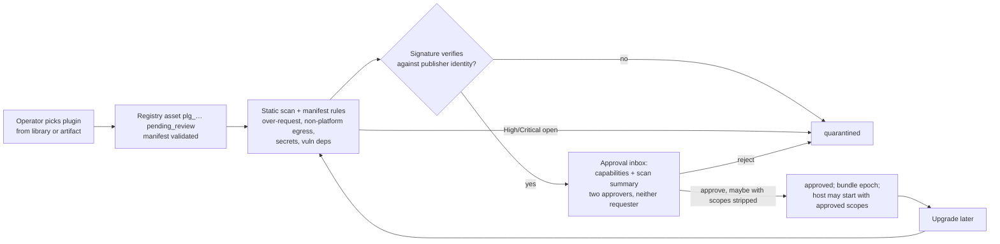

# E. Architecture package

[Package index](README.md) · Previous: [D. Threat model](d-threat-model.md) · ADRs: [E2](e2-adrs.md) · Next: [F. Data contracts](f-data-contracts.md)

Sections 1 to 18 carry the Claude run with the DeepSeek-only items folded in (**[DS]**) and the three additions
threaded through. Sections 19 to 21 are new: the connector framework and NHI inventory, the plugin platform,
and workflow intelligence.

## 1. Enforcement approaches compared

| Approach | What it sees | Can it *prevent*? | Bypass | Deployment cost | Verdict |
|:--|:--|:--|:--|:--|:--|
| **Centralized proxy / gateway** | Any LLM, MCP or A2A call addressed to it | Yes, per request and per tool call | Agent calls upstream directly; local tools never touch it | Low: one service, client base-URL change | **Core PEP** for network calls |
| **Runtime adapter / sidecar** | Local tool use (shell, file, browser) via the runtime's hook API; stdio MCP via wrapper | Yes, where the runtime offers a blocking pre-tool hook **[V]** per runtime | User disables the hook or edits config on an unmanaged device | Medium: one adapter per runtime, version churn; adapters become plugins in Phase 3 | **Required** for CLI agents; the only way to see local actions |
| **SDK interception** | Calls made through an instrumented framework | Yes, in-process | Code that doesn't use the SDK; trivial to skip | Medium: per language and framework | **Phase 2** for server-side agents; convenience, not a security boundary |
| **Network egress control** | Every outbound connection's destination (host/SNI); not payloads without TLS interception | Yes, by destination | Unmanaged networks; tunnels over allowed hosts | Medium: proxy + device or network config | **Backstop**: turns bypass into a refused connection |
| **OS / kernel mediation** (eBPF, endpoint agent) | Processes, files, sockets | Partly | Root on the host | High; overlaps EDR | **Research** (Phase 4); integrate with EDR rather than build |
| **Credential brokering** | Every use of a brokered credential | Yes: no decision, no credential | Credentials the org didn't broker (personal keys) | Medium | **Core**: makes bypass useless for governed systems |
| **Platform connectors** [new] | Identities, keys, roles and automations *as the platform records them*, whether or not any agent traffic passed a PEP | No at request time; **yes at lifecycle time** (disable, rotate, revoke through the platform, with approval) | Platforms with no connector; platforms that lie | Medium per platform; shared SDK and host | **Inventory and lifecycle layer**: governs the credentials behind the agents |

### Recommendation: hybrid, layered by what each layer can actually see **[R]**

```text
Layer 1  PDP (one brain)            every PEP asks the same question, gets the same answer, logs the same event
Layer 2  Gateway (LLM, MCP, A2A)    primary PEP for anything network-borne
Layer 3  Runtime adapter + wrapper  local tool use and stdio MCP on agent hosts
Layer 4  Credential broker          no allow decision → no credential, whatever path the agent took
Layer 5  Egress proxy               anything not going through layers 2 to 4 hits a default-deny wall
Layer 6  Discovery + coverage       reports what layers 2 to 5 can't see, as "unmonitored"
Layer 7  Connectors (via plugins)   the identities and automations behind the agents, on every connected platform,
                                    with lifecycle actions back; "not connected" is reported like "unmonitored"
```

Layers 1 to 5 are the **enforcement hot path**. Layer 6 and 7, the scan pipeline, the **plugin host** and
**workflow intelligence** are management-side: they feed the registry and the policy bundle, and they are never
in the latency budget of a tool call. That split is deliberate: extension code (plugins) and batch analytics
(WFI) can be slow, crash or be wrong without a single request failing open or slow (NFR-17).

**Limitations, stated plainly:**
- A user with admin rights on an unmanaged machine can run any agent with a personal key, and ASCC will see
  nothing. Coverage reporting is the honest answer; preventing it is an endpoint-management problem.
- Layer 3 depends on each vendor's hook API. If a runtime has no blocking hook, that runtime is *observed* at
  best, through the gateway and egress layers.
- Payload inspection needs the traffic to be addressed to the gateway. ASCC does not do blanket TLS interception
  by default ([B Q11](b-discovery-questions.md)).
- Misuse of a **permitted** tool within its argument constraints is allowed by design; detection and budgets are
  the only controls there.
- A connector shows what the platform's API returns. A platform without a connector, or a platform that
  withholds data, is a gap reported as `not_connected` or `stale`, not covered.
- Plugins are bounded by scopes, egress and the gate; nothing proves a third-party binary benign.

## 2. Planes

| Plane | Components | State | Failure impact |
|:--|:--|:--|:--|
| **Management** | Mgmt API, console, registry (incl. NHI inventory), policy store, approval engine, scan orchestrator, **plugin host and its plugins (connectors first)**, **WFI engine** | Postgres | New registrations, policy changes, syncs and findings stop; enforcement continues on cached bundles |
| **Policy decision** | PDP service + embedded PDP library in each PEP | Signed policy bundles, entity snapshots, revocation list | Tiered fail behaviour (§9) |
| **Enforcement** | Gateway (LLM/MCP/A2A adapters), runtime adapter, stdio wrapper, egress proxy, credential broker | Mostly stateless; MCP sessions are sticky | Calls through that PEP fail closed for tiers 2 and 3 |
| **Telemetry / data** | Event ingest, audit chain writer, OTel collector, trace store, SIEM exporter | Postgres (MVP), ClickHouse + object store (Phase 3) | Tier 2/3 allows block until audit is durable (NFR-06) |
| **Scanning** | Ingest workers, static scanners, sandbox runners (P1), findings store; **scans plugin artifacts too** | Postgres + artifact cache | Onboarding and plugin installs stall; runtime unaffected |
| **Secrets** | OpenBao/Vault (external), broker, KMS for signing keys (customer-owned in production [DS]) | External | Brokered calls fail closed; connectors can't authenticate to platforms |

Trust levels [DS]: management, policy decision, telemetry and secrets planes are high trust; the enforcement
plane is medium (exposed to agents); the scan sandbox and the **plugin host's tenants** are untrusted input.
The plugin host *process* is high trust; what runs under it is not.

## 3. Component diagram

```mermaid
flowchart TB
  subgraph Clients
    CC[CLI agent<br/>e.g. Claude Code]
    SDK[SDK / framework agent]
    MCPC[Any MCP client]
    OPS[Operators<br/>browser]
    DEV[Plugin developer<br/>SDK + harness]
  end
  subgraph Edge["Agent host (managed)"]
    HOOK[Runtime adapter<br/>pre-tool hook client]
    WRAP[stdio MCP wrapper]
  end
  subgraph Enforcement
    GW[ASCC Gateway<br/>LLM | MCP | A2A adapters<br/>embedded PDP + cache]
    BR[Credential broker]
    EGP[Egress proxy<br/>default deny]
  end
  subgraph Control
    API[Mgmt API<br/>REST + OpenAPI]
    UI[Console<br/>React]
    PDP[PDP service<br/>Cedar]
    STS[Token service<br/>token exchange, JWKS]
    BUS[Control channel<br/>bundles, revocations, kills]
    SCO[Scan orchestrator]
    AUD[Audit writer<br/>hash chain + checkpoints]
    WFIE[Workflow intelligence<br/>batch engine]
  end
  subgraph PluginHost["Plugin host (out of process)"]
    PH[Host: capability tokens,<br/>egress allowlist, limits, health]
    CON1[Connector: OpenBao]
    CON2[Connector: GitHub]
    CON3[Connector: config collector]
    PLX[Other plugins P1:<br/>scanners, detectors, notifiers]
  end
  subgraph Data
    PG[(Postgres<br/>registry, NHI, policy, approvals,<br/>audit, findings, workflows)]
    OTC[OTel collector]
    TR[(Trace store)]
  end
  subgraph Scan["Scan sandbox (isolated)"]
    SW[Scanner workers<br/>gitleaks, OSV, Semgrep,<br/>ASCC rules, manifest rules]
  end
  subgraph External
    IDP[(IdP)]
    VLT[(OpenBao / Vault + KMS)]
    LLM[(LLM providers)]
    MCPS[(MCP servers)]
    SIEM[(SIEM)]
    NHIS[(NHI sources<br/>GitHub, OpenBao, AWS, Entra,<br/>GCP, Okta, K8s, AD, CI, n8n)]
    LIB[(Plugin library index<br/>metadata, signatures, scans)]
  end
  CC --> HOOK --> PDP
  CC --> WRAP --> GW
  CC --> GW
  SDK --> GW
  MCPC --> GW
  GW --> BR --> VLT
  GW --> LLM & MCPS
  SDK -.-> EGP
  CC -.-> EGP
  OPS --> UI --> API
  API --> PG
  API --> STS
  STS --> VLT
  API --> SCO --> SW
  LIB --> SCO
  BUS --> GW & HOOK & WRAP & EGP & PH
  API --> BUS
  GW & HOOK & WRAP & EGP --> AUD --> PG
  PH --> AUD
  GW & HOOK & WRAP --> OTC --> TR
  AUD --> SIEM
  IDP --> API & STS
  API <--> PH
  PH --> BR
  PH --> CON1 & CON2 & CON3 & PLX
  CON1 & CON2 & CON3 -- platform APIs<br/>via host egress --> NHIS
  PG --> WFIE --> PG
  DEV -. submit .-> LIB
```

## 4. Components

| Component | Responsibility | Tech **[R]** | Scales by | Notes |
|:--|:--|:--|:--|:--|
| **Mgmt API** | Registry CRUD (assets, NHIs, workflows, plugins), lifecycle, approvals, grants, kill orchestration, coverage, plugin install gate | Go, REST, OpenAPI 3.1, Postgres | Stateless replicas | Single writer of registry state; plugins write only through it, in their namespace |
| **Console** | MVP screens (FR-ADM-01) incl. NHI list, installed plugins, approval inbox, scan queue | React 19 + TypeScript + Vite | Static | No business logic beyond display; everything via API; plugin panels (P1) render in a sandboxed frame |
| **Token service (STS)** | Agent instance enrolment, token exchange (RFC 8693), transaction token minting, JWKS; accepts SPIFFE SVIDs as instance proof for server agents (P1) [DS] | Go; signing via vault transit / customer KMS | Stateless | Keys never leave KMS ([ADR-06](e2-adrs.md#adr-06)) |
| **PDP** | Cedar evaluation; entity assembly; decision log emission | Go + Cedar library ([ADR-03](e2-adrs.md#adr-03)) | Embedded in each PEP; central service for remote PEPs | Same bundle everywhere |
| **Gateway** | LLM (Anthropic Messages, OpenAI-compatible), MCP (Streamable HTTP, OAuth 2.1 resource server [DS]), A2A (observe in MVP) adapters; authz; obligations; metering; correlation | Go ([ADR-04](e2-adrs.md#adr-04)) | Replicas; MCP session affinity by `Mcp-Session-Id` **[V]** | Spike vs. extending an existing open-source agent gateway first |
| **Runtime adapter** | Hook handler for a CLI agent; calls PDP; local decision cache; heartbeat | Go single binary | Per host | Hook contract per runtime **[V]**; further runtimes as `runtime_adapter` plugins (P2) |
| **stdio wrapper** | Launch MCP server as child; proxy JSON-RPC over stdio with gateway-equivalent checks | Same binary as adapter | Per server process | Shares MCP logic with gateway as a Go package |
| **Credential broker** | Fetch secret by reference after an allow with `inject_credential`; inject into upstream request; never return to caller; **also performs platform calls for connectors on the host's request** | Go package inside gateway (MVP), callable by the plugin host over mTLS | With gateway | The host never hands the plugin a value; it hands the broker a request |
| **Egress proxy** | Default-deny forward proxy; allowlist per agent identity **and per plugin**; logs | Off-the-shelf proxy with an authz callout ([ADR-08](e2-adrs.md#adr-08)) | Replicas | Identity via proxy auth or source mapping; plugin containers route through it |
| **Control channel** | Push policy bundles, revocation lists, kill commands (incl. `disable_plugin`); collect acks from PEPs and the plugin host | gRPC server-stream from API to PEPs (MVP) ([ADR-09](e2-adrs.md#adr-09)) | API replicas + Postgres LISTEN/NOTIFY fan-out | Every message carries a monotonic epoch |
| **Audit writer** | Append events with hash chain; periodic signed checkpoint; export | Go; Postgres table with append-only grants | Partition by tenant | ([ADR-10](e2-adrs.md#adr-10)); the plugin host is an audit client, plugins are not |
| **Scan orchestrator + workers** | Fetch, pin, run scanners, normalize findings, update lifecycle; **scan plugin artifacts and manifests** | Go orchestrator; containerized scanners; scanner plugins (P1) run under the plugin host, not in the sandbox | Queue workers | Workers have no DB credentials; results via queue |
| **Plugin host** [new] | Start/stop plugins as processes or containers; mint capability-scoped tokens; per-plugin egress allowlist and resource limits; health and restart; proxy plugin API calls to the Mgmt API and broker; emit events with `plugin_id`; apply `disable_plugin` | Go ([ADR-15](e2-adrs.md#adr-15)); containers in Compose/Kubernetes, processes on laptops | One host per deployment node; plugins scale by instance | §20. Not on the hot path. The only route from a plugin to anything |
| **Connector plugins** [new] | Discover and enrich NHIs and AI assets on one platform; optional lifecycle actions; report coverage | Go SDK (MVP); Python/TS SDKs (P1); one plugin per platform | Per connector instance | §19. MVP: OpenBao/Vault, GitHub, config collector |
| **Plugin library index** [new] | Public, static index of plugins: manifest, signature, scan summary, trust tier, compatibility | Git repository + static site in the org; console reads it over HTTPS; local mirror for air-gapped (NFR-15) | CDN / static | Metadata only; never hosts running code |
| **Workflow intelligence engine** [new] | Build fingerprints from registry, connectors and daily event rollups; run overlap and hygiene rules as a batch; write `optimization_finding`s; route proposals | Go batch job (deterministic rules); optional local embedding service (P2) ([ADR-17](e2-adrs.md#adr-17)) | Scheduled job; one run per tenant | §21. Off the hot path; reads Postgres, writes findings |

## 5. Protocol adapters: what differs **[V]** all against current specs

| Concern | LLM API (Anthropic Messages, OpenAI-compatible) | MCP | A2A |
|:--|:--|:--|:--|
| Shape | Request/response, optional SSE streaming | JSON-RPC 2.0; Streamable HTTP or stdio transports; server can stream and send requests to the client | JSON-RPC over HTTP with streaming; gRPC binding in newer versions **[V]** |
| State | Stateless per request | Session (`initialize`, capabilities negotiation, session ID header) | Task lifecycle with IDs and states |
| Discovery | Static model list | `tools/list`, `resources/list`, `prompts/list`; list-changed notifications | Agent Card at a well-known URL **[V]** path |
| Auth model | Bearer API key | OAuth 2.1-based authorization for HTTP transports; **the gateway acts as an OAuth 2.1 resource server and publishes RFC 9728 protected-resource metadata so compliant clients discover how to authenticate** [DS] **[V]**; none for stdio (process trust only [DS]) | Declared in Agent Card security schemes **[V]** |
| Where ASCC acts | Request: model allowlist, budget, DLP. Response: metering, optional inspection | `tools/list` filter, `tools/call` authz + args, description pinning, result tagging; server→client requests (sampling, elicitation) governed in P1 | MVP: fetch and record Agent Card, log task events, coverage `observed` [DS]. P1: card validation, per-task authz, token propagation |
| Streaming risk | Output DLP mid-stream needs buffering or cut-off | Long-lived streams; per-message checks | Streaming task updates |
| Auth boundary | Gateway holds provider key (brokered); agent holds an ASCC token | Gateway is the OAuth client to upstream servers on the agent's behalf; agent authenticates to gateway with its transaction token | Gateway authenticates to remote agent; forwards transaction token as delegated identity (P1) |

The gateway does **not** pass the agent's ASCC token to upstream MCP servers (token passthrough is an
anti-pattern in the MCP security guidance **[V]**). It obtains its own upstream credential via the broker.

## 6. Bypass routes and coverage

Every row is a test in [I §3](i-validation.md) and a row in the coverage panel.

| # | Bypass route | Layer that catches it | Coverage status |
|:--|:--|:--|:--|
| B1 | Agent calls LLM provider directly (base URL changed) | Egress proxy on managed host ⛔ | Enforced (managed) / unmonitored (unmanaged) |
| B2 | MCP client configured to the server URL, not the gateway | Egress ⛔ (server host not allowed directly); broker has no creds for direct path ⛔ | Enforced (managed) |
| B3 | stdio MCP server launched without the wrapper | Config discovery 🔍; adapter refuses unregistered servers if runtime hook covers MCP tools **[V]** | Observed |
| B4 | CLI hook removed or adapter killed | Heartbeat loss → unmonitored 🔍; egress still enforced ⛔ | Partially enforced |
| B5 | Agent spawns a subprocess that opens sockets | Egress ⛔ (if host-level proxy is mandatory, e.g. firewall rule) | Enforced only with host firewall |
| B6 | Local file reads outside project | Runtime hook for the file tool ⛔; shell `cat` via Bash tool → command policy (pattern-based, weak) ⛔/🔍 | Partially enforced |
| B7 | Personal API key on unmanaged device | None | Unmonitored (reported) |
| B8 | Agent framework not using the SDK interceptor | Gateway if base URL forced; else egress | Enforced at egress |
| B9 | Exfil inside allowed destination (e.g. allowed GitHub repo) | Argument constraints ⛔; DLP ⛔/🔍 | Partially enforced |
| B10 | DNS tunnelling | Resolver allowlist on managed hosts ⛔ (P2) | Unmonitored until P2 |
| **B11** | Platform in the estate with no connector (NHIs and automations there are invisible) | Nothing; the estate list vs connector list 🔍 | **Not connected** (reported per platform) |
| **B12** | Plugin code run outside the plugin host (someone starts a connector binary by hand with a real credential) | It has no capability token, so every Mgmt API call is refused ⛔; it has no brokered credential unless the operator pasted one (then it is an ordinary rogue process with a platform secret: T-23) | Enforced for ASCC's own surface; the platform secret is the operator's problem and shows up as an unexplained `last_used` on the NHI 🔍 |

## 7. Flows

### 7.1 Agent invocation (LLM + MCP tool call through the gateway)

```mermaid
sequenceDiagram
  autonumber
  participant U as User (Alice)
  participant A as CLI agent
  participant H as Runtime adapter
  participant S as STS
  participant G as Gateway (PEP + embedded PDP)
  participant B as Broker
  participant V as Vault
  participant L as LLM provider
  participant M as MCP server
  participant AU as Audit
  U->>A: task "triage issue #42"
  A->>S: token exchange (Alice's session token + instance proof)
  S-->>A: transaction token (sub=alice, act=[agent:triage], task=t1, depth=1, ttl=15m)
  A->>G: POST /llm/anthropic/v1/messages (txn token)
  G->>G: verify token, check model allowlist, task budget
  G->>B: inject_credential(provider_key_ref)
  B->>V: read secret (gateway's vault role)
  G->>L: request with provider key
  L-->>G: response (tool_use: github.get_issue)
  G->>AU: event llm.request (allow, tokens, cost)
  G-->>A: response
  A->>H: pre-tool hook: mcp github.get_issue
  H-->>A: allow (cached tier 1)
  A->>G: MCP tools/call github.get_issue {repo, number}
  G->>G: PDP: alice ∩ agent grant ∩ task scope → permit (args within repo allowlist)
  G->>B: inject_credential(github_token_ref)
  G->>M: tools/call with upstream auth
  M-->>G: result
  G->>G: tag result untrusted; set session.untrusted_ingested
  G->>AU: event mcp.tool_call (allow, policy ids, chain hash)
  G-->>A: result
```

### 7.2 Onboarding: register → scan → approve

```mermaid
sequenceDiagram
  autonumber
  participant D as Developer
  participant API as Mgmt API
  participant SO as Scan orchestrator
  participant W as Scanner workers (sandbox)
  participant O as Owner / AppSec
  participant BUS as Control channel
  D->>API: register mcp_server (git url@commit, declared tools, egress hosts)
  API->>API: state=pending_review, owner+backup required
  API->>SO: scan request (digest)
  SO->>W: fetch + pin + run static scanners
  W-->>SO: findings (rule, severity, evidence)
  SO->>API: findings; gate = blocked if High/Critical open
  API-->>O: approval task (findings summary, risk tier) in the approval inbox
  alt findings clean or exemption granted (expiring)
    O->>API: approve (pins tool description digests)
    API->>API: state=approved; attestation recorded
    API->>BUS: new bundle epoch (entity + pins)
  else rejected
    O->>API: reject → quarantined
  end
```

The same flow gates a plugin install (§20.3), with the manifest capability check added to the scan and the
capabilities shown to the approver.

### 7.3 Delegated tool invocation across a sub-agent

```mermaid
sequenceDiagram
  autonumber
  participant O as Orchestrator agent
  participant S as STS
  participant D as Deploy agent
  participant G as Gateway
  O->>S: exchange(subject_token=txn[sub=alice, act=[O], depth=1], audience=agent:deploy, scope=deploy:staging)
  S->>S: check O may_delegate_to D; depth+1 ≤ max; scope ⊆ parent scope; no cycle
  S-->>O: txn token [sub=alice, act=[O,D], depth=2, scope=deploy:staging, budget=parent remainder]
  O->>D: A2A/RPC task with token
  D->>G: tools/call k8s.apply (token)
  G->>G: PDP: alice ∩ O ∩ D ∩ scope → permit staging only
  G-->>D: result (prod target would be denied)
```

### 7.4 Emergency shutdown (suspend agent)

```mermaid
sequenceDiagram
  autonumber
  participant OP as Operator
  participant API as Mgmt API
  participant V as Vault
  participant BUS as Control channel
  participant P as PEPs (gateway, adapters, wrapper, egress, plugin host)
  participant AU as Audit
  OP->>API: POST /v1/containment {action: suspend_agent, target: agent:triage, reason}
  API->>API: authz operator (role, two-person if fleet scope)
  API->>AU: containment.requested
  API->>V: revoke leases / rotate brokered creds bound to agent (if configured)
  API->>BUS: revocation(epoch N+1: agent:triage suspended, jti list)
  BUS->>P: push
  P->>P: apply: deny new calls; terminate open MCP sessions / streams
  P-->>BUS: ack(epoch N+1, pep_id, sessions_closed)
  BUS-->>API: acks
  API->>AU: containment.acknowledged per PEP
  API-->>OP: status: 5/6 acknowledged, 1 unconfirmed (adapter host-17 offline) → escalate
```

## 8. Kill-switch semantics

"Stopped" means different things per runtime. The console shows which one applies.

| Target | Stopped means | Confirmed by | When disconnected |
|:--|:--|:--|:--|
| Gateway path | New requests denied; open streams closed; MCP sessions terminated | Gateway ack with session count closed | N/A (gateway is the PEP) |
| CLI agent with adapter | Every subsequent tool call denied by hook; agent process **not** killed (ASCC doesn't own the process) | Adapter ack | Token TTL + vault revocation bound the window; status `unconfirmed` |
| stdio MCP via wrapper | Wrapper rejects calls and terminates the child server | Wrapper ack | As above |
| Server agent in container | Gateway + egress deny; optionally orchestrator scales to zero via integration (P2) | Gateway + egress acks | Network policy remains |
| Brokered credential | Lease revoked / secret rotated in vault | Vault API response | Effective immediately for the credential |
| Unmanaged agent | Nothing ASCC can stop; credential revocation is the lever | — | Reported `uncontrollable` |
| **Plugin** [new] | Host stops the process or container, revokes its capability token (every further API call is 401), drops its egress allowlist; data the plugin provided is marked `stale` in coverage | Plugin host ack with `plugin_id` and process exit status | A host that is offline shows `unconfirmed`; the token still expires at its TTL (≤ 1 h) and the API rejects revoked `plugin_id`s immediately |
| **NHI via connector** [new] (P1) | The owning platform disables or revokes the identity (API call made by the broker on the connector's behalf); ASCC records before/after state | Connector `Act` result + a follow-up `Enrich` read showing the new state | Platform or connector down → `unconfirmed`; the operator is told to act in the platform console; nothing is assumed |

Rules: kills are idempotent and carry epochs; a PEP that sees epoch N+1 never accepts an allow from bundle ≤ N
for the killed subject; resume is a new action, never a timeout. The same applies to the plugin host.

## 9. Failure modes and fail-open/closed

Action tiers (assigned by policy on each action/resource; default tier 2):

| Tier | Examples | PDP unreachable | Audit unavailable | Gateway down |
|:--|:--|:--|:--|:--|
| 1 Read, low sensitivity (incl. observability-only paths [DS]) | List issues, read public docs, LLM call with no tools | Serve cached decision ≤ 5 min old, mark event `degraded` | Buffer locally (bounded), allow | Client fails; no bypass |
| 2 Write internal / sensitive read | Create issue, read internal repo, write file in project | **Deny** | **Deny** | Fail |
| 3 External send, credentials, prod, destructive, privilege change, **NHI lifecycle actions** | Send email, post to external URL, prod deploy, delete, disable a service account | **Deny** | **Deny** | Fail |

| Failure | Detection | Behaviour | Recovery |
|:--|:--|:--|:--|
| PDP service down (remote PEPs) | Health check | Tiered as above; embedded PDP in gateway keeps working on its bundle | Restart; bundles re-pushed |
| Bundle older than `max_staleness` (default 10 min) | Epoch age | Tiers 2/3 deny | Reconnect control channel |
| Control channel partition | Missing heartbeat | PEP keeps last bundle within staleness; API marks PEP stale | Auto reconnect; full resync |
| Postgres down | Health | Mgmt plane read-only/off; audit writer buffers to local disk up to limit, then tier 2/3 deny | Replay buffer; chain continues |
| Vault down | Broker errors | Brokered calls fail (closed); connector syncs fail, coverage goes `stale` | Vault HA (Phase 3) |
| IdP down | Login failures | Existing tokens valid until TTL; no new sessions | IdP's own HA |
| Scanner backlog | Queue depth | Onboarding and plugin installs wait; runtime unaffected | Scale workers |
| **Plugin crash or hang** [new] | Host health probe, heartbeat miss, resource limit hit | Host kills and restarts with backoff (≤ 10 s, NFR-17); the plugin's data is `stale` after 2 intervals; **gateway and PDP latency unaffected** (FAIL-12) | Automatic; after N restarts the plugin is `restricted` and the owner alerted |
| **Plugin host down** [new] | Control-channel heartbeat | No syncs, no plugin-sourced findings; enforcement continues; coverage for every plugin-provided view goes `stale` | Restart host; plugins restart from their cursors |
| **Connected platform API down or rate-limited** [new] | Connector `Health` and sync errors | Sync marked failed; last inventory kept with `freshness` growing; lifecycle actions refused while the connector is unhealthy (fail closed for tier 3) | Backoff and retry; coverage shows `error` then `stale` (FAIL-13) |
| **WFI batch failure** [new] | Job status | No new findings; existing proposals untouched; nothing else affected | Rerun; findings are idempotent on (class, workflow set) (FAIL-14) |
| Break-glass | Two admins enable a time-boxed `degraded_allow` policy for named tier 2 actions | Every event flagged `break_glass`; alert to all admins | Auto-expire ≤ 4 h |

## 10. Distributed policy cache consistency

- **Bundle model:** policies + entity snapshot (agents, grants, lifecycle, pins, plugin lifecycle) compiled into a
  signed bundle with a monotonic `epoch`. PEPs evaluate locally.
- **Two speeds:** full bundles on change (seconds); **revocations and kills** as small deltas on the same
  channel, applied immediately and also folded into the next bundle.
- **Bounded staleness**, not strong consistency: a PEP may be up to `max_staleness` behind for grants (a new
  grant may take seconds to work: acceptable), but revocations are push-first and tokens are short-lived, so a
  revoked subject is denied within NFR-05 on connected PEPs. Each decision log records the bundle version so a
  stale PEP is detectable after the fact [DS].
- **Monotonic epochs** prevent rollback: a PEP rejects a bundle with an epoch lower than one it has seen.
- **Per-request context** (task budget remaining, session taint) lives in the gateway's session state, not the
  bundle; for multi-replica gateways it's in Postgres (MVP) or Redis/Valkey (Phase 3) with atomic decrement.
  Budget accounting is approximate across replicas within one in-flight request per replica; documented.
- **NHI and workflow data are not in the bundle.** They are management-plane records; only the derived
  lifecycle and risk-tier attributes of registered agents reach policy (§14).

## 11. Streaming traffic

- LLM streaming: request-side checks complete before forwarding; response is streamed through with token
  metering, never fully buffered [DS]. Output DLP in blocking mode requires holding back a sliding window (adds
  latency) or cutting the stream on detection (partial content already delivered). **[R]** MVP: no blocking
  output DLP on streams; detection-only with stream cut for deterministic credential matches.
- MCP Streamable HTTP: each JSON-RPC message is parsed; `tools/call` requests are authorized before forwarding;
  server-initiated requests (sampling, elicitation) are blocked by default in MVP and governed in P1.
- Kill applies mid-stream: gateway closes the stream and returns a protocol-appropriate error.

## 12. Tenant isolation

| Layer | MVP (single tenant, built for many) | Phase 3 multi-tenant |
|:--|:--|:--|
| Data | `tenant_id` on every row incl. NHIs, workflows, plugin installs; Postgres RLS policies enabled and tested | Same + per-tenant encryption keys for content |
| Policy | Bundles per tenant; Cedar entities namespaced by tenant | Same |
| Tokens | `tenant` claim; issuer per tenant optional; plugin capability tokens carry `tenant` | Per-tenant signing keys |
| Audit | Separate hash chain per tenant | Separate checkpoint keys |
| Caches | Tenant in every cache key | Same + isolation tests in CI |
| Compute | Shared | Optional dedicated gateway pools and plugin hosts per tenant |

## 13. Performance budgets and scaling (targets, not measurements)

| Step | Budget (p95) |
|:--|:--|
| Token verification (cached JWKS) | 0.5 ms |
| PDP evaluation (embedded) | 2 ms |
| Policy obligations (credential injection, cached lease) | 3 ms |
| Deterministic DLP on args (< 64 KB) | 3 ms |
| Audit write (synchronous insert, tier 2/3) | 10 ms |
| Proxy overhead | 5 ms |
| **Total added** | **median ≤ 5 ms [DS], p95 ≤ 25 ms, p99 ≤ 50 ms** (NFR-02) |

ML detectors (injection, PII) are excluded and must be async or opt-in inline with their own budget. Plugins are
never on this path in MVP; a future WASM detector plugin gets its own budget line (ADR-15). Scaling: gateway
replicas behind a load balancer with MCP session affinity; PDP embedded so it scales with gateways; audit writes
batched for tier 1; event ingest sized for 1,000 events/s sustained [DS] (NFR-09). A Phase 1 load test
establishes real numbers.

## 14. How governance and scanning become runtime enforcement

| Governance fact | Compiled into | Enforced at |
|:--|:--|:--|
| Asset lifecycle state | Cedar entity attribute `lifecycle` + `forbid` unless approved/restricted | Gateway, wrapper, adapter |
| Approved tool description digests | Pin table in bundle | Gateway / wrapper on `tools/list` |
| Scan gate result | Lifecycle transition (only `approved` is callable) | As above |
| Exemption expiry | Scheduled job flips lifecycle → `restricted` / `pending_review`, new epoch | As above |
| Grants (incl. JIT expiry) | Cedar entities with `expires_at`; policy checks `context.now < expires_at` | All PEPs |
| Owner orphaned | Lifecycle → `restricted` (tier 1 only) | All PEPs |
| Egress allowlist | Per-agent (and per-plugin) host set in bundle | Egress proxy callout |
| Kill / revocation | Delta message + bundle | All PEPs and plugin host |
| Risk tier | Entity attribute used in policy conditions (e.g. tier 3 → approval obligation) | All PEPs |
| **Plugin lifecycle** [new] | `plugin.lifecycle` entity attribute; `forbid plugin.start unless approved`; approved capability list → token scopes | Plugin host (start permission, token minting), Mgmt API (per-call scope check) |
| **NHI hygiene findings** [new] | `ownerless` / `stale` / `over_privileged` on an NHI an agent `uses_nhi` → raises the agent's residual risk input and opens an attestation; P1: policy may require approval for tier 3 actions by an agent whose credential is `over_privileged` | Attestation job; PDP via the agent's risk attributes (never a permit, FR-POL-09) |
| **Workflow findings** [new] | Signal into residual risk (EP-19) only; never a bundle attribute that permits | Nothing at request time, by design |

## 15. Privacy, audit integrity, keys, retention

- **Data minimization:** events carry identifiers, decisions, sizes, hashes and classifications, not content.
  Tool arguments are stored as a keyed hash plus a redacted preview of whitelisted fields per tool (e.g. repo
  name yes, issue body no). NHI records carry metadata about a credential (ID, age, scopes), never the credential.
  Workflow fingerprints carry declared purpose text and metadata; prompt content only where capture is on.
- **Audit integrity:** each event row stores `prev_hash` and `hash = SHA-256(canonical_json(event) || prev_hash)`.
  Every 5 minutes (or 10k events) a checkpoint `{tenant, seq, hash, time}` is signed with a KMS key and exported
  to a WORM target (object storage with retention lock, or a separate append-only service). Verification
  replays the chain between checkpoints. Tamper-evident, not tamper-proof.
- **Key ownership.** In production the **customer owns the root signing keys in their KMS/HSM; ASCC holds no
  tenant root key** [DS]. The dev Compose stack uses OpenBao transit keys it generates itself, and the production
  profile refuses to start on dev keys (FR-SEC-05).

  | Key | Owner | Location | Rotation |
  |:--|:--|:--|:--|
  | Transaction-token signing | Customer (operated by ASCC STS) | Customer KMS / vault transit | 90 days, overlapping JWKS |
  | Audit checkpoint signing | Customer security team (not ASCC admins) | Customer KMS, separate key | Yearly; old public keys retained |
  | Policy bundle signing | ASCC control plane | Customer KMS / vault transit | 90 days |
  | **Plugin capability-token signing** [new] | ASCC plugin host | Vault transit / customer KMS | 30 days; tokens TTL ≤ 1 h so rotation is cheap |
  | **Plugin artifact signing** [new] | The plugin publisher (core team for `core`, each publisher for `verified`/`community`) | Publisher's key; Sigstore keyless with identity binding preferred **[V]** | Per publisher; the index records the identity, the host verifies on install and on start |
  | Content encryption (if enabled) | Data owner / DPO | KMS, per tenant | Per data policy; crypto-shred on deletion |
  | Agent instance keys | Agent host | Local keystore (OS-protected) | On enrolment; revocable |

- **Retention:** metadata 13 months (≈ 400 days) default [DS]; content 30 days; checkpoints indefinitely;
  NHI history (permission and usage snapshots) follows metadata retention; workflow findings until resolved plus
  13 months. Deletion jobs skip records under legal hold. Hash chain survives deletion by keeping per-event hashes
  (payload deleted, hash retained), so verification still works after retention. DSAR export by principal ID.

## 16. Technology options and decision matrix

Scores 1 to 5 (5 best) for this product's needs. Licences **[V]** before adoption. Full reasoning in [E2](e2-adrs.md).

| Component | Option | Fit | Ops cost | Maturity | Licence | Pick |
|:--|:--|:--|:--|:--|:--|:--|
| Authz engine | **Cedar** | 5 typed, deny-overrides, analyzable | 4 library | 4 | Apache-2.0 | ✅ ADR-03 (spike: Go parity); DeepSeek weighted matrix 0.78 vs OPA 0.80 [DS] |
| | OPA / Rego | 4 general purpose | 4 | 5 | Apache-2.0 | Alternative |
| | OpenFGA / SpiceDB | 3 ReBAC only, needs ABAC on top | 3 separate service | 4 | Apache-2.0 | Phase 3 option for very large graphs |
| Gateway base | **Custom Go** | 5 MCP semantics native | 3 we own it | 2 new | Own | ✅ ADR-04, after spike |
| | agentgateway (LF project) **[V]** | 4 MCP + A2A aware | 4 | 2 young | Apache-2.0 **[V]** | Spike candidate; adopt if extension model fits |
| | Envoy + ext_proc | 3 MCP parsing in callouts | 2 | 5 | Apache-2.0 | Edge TLS only |
| | LiteLLM proxy | 3 LLM strong, MCP newer | 4 | 4 | MIT core, enterprise features separate **[V]** | Rejected as core: Python perf + licence split |
| Secrets | **OpenBao** | 5 | 3 | 3 | MPL-2.0 | ✅ default bundled ADR-07 |
| | HashiCorp Vault | 5 | 3 | 5 | BUSL-1.1 **[V]** | Supported via connector plugin, not bundled |
| | Cloud secret managers | 4 | 5 | 5 | Commercial | Connector plugins (P1) |
| Workload identity (P1) | SPIFFE/SPIRE | 5 | 2 | 4 | Apache-2.0 | ✅ server and Kubernetes agents from Phase 2 [DS] |
| IdP (dev) | **Keycloak** | 5 | 3 | 5 | Apache-2.0 | ✅ dev/pilot |
| | Authentik / Zitadel | 4 | 4 | 3 to 4 | Mixed **[V]** | Alternatives |
| Registry + audit store | **PostgreSQL** | 5 RLS, JSONB, one DB | 5 | 5 | PostgreSQL | ✅ ADR-05; NHI and workflow tables live here too |
| Event analytics (Phase 3) | ClickHouse | 5 | 3 | 5 | Apache-2.0 | ✅ Phase 3 |
| | OpenSearch | 4 | 2 | 5 | Apache-2.0 | Alternative |
| Event bus (Phase 3) | NATS JetStream | 4 | 4 | 4 | Apache-2.0 | ✅ when Postgres fan-out outgrown |
| | Kafka | 4 | 2 | 5 | Apache-2.0 | Alternative at very high volume |
| Traces | **OTel Collector + Grafana Tempo / Jaeger** | 5 | 4 | 5 | Apache-2.0 / AGPL-3.0 (Tempo) **[V]** | ✅ Jaeger in dev (avoid AGPL question); Grafana/Prometheus dashboards [DS] |
| Egress proxy | **Envoy (forward proxy, ext_authz)** | 4 | 3 | 5 | Apache-2.0 | ✅ ADR-08 |
| | Squid + ICAP/helper | 3 | 4 | 5 | GPL-2.0 | Alternative (separate process, licence fine for use) |
| | Smokescreen | 3 | 5 | 4 | MIT **[V]** | Simplest; limited per-identity policy |
| Static scanners | gitleaks, OSV-Scanner, Semgrep CE, Syft/Grype + ASCC rules | 4 | 4 | 4 to 5 | MIT / Apache-2.0 / LGPL-2.1 (Semgrep engine; rule licences vary **[V]**) | ✅ ADR-11 |
| Sandbox (P1) | **gVisor** | 4 | 4 | 4 | Apache-2.0 | ✅ |
| | Firecracker microVMs | 5 isolation | 2 | 4 | Apache-2.0 | Phase 3 for hostile binaries |
| Audit anchoring (P3) | Trillian Tessera / Sigstore Rekor-style log **[V]** | 4 | 2 | 3 | Apache-2.0 | Phase 3 option |
| Console | **React 19 + TS + Vite** | 5 | 5 | 5 | MIT | ✅ house standard |
| **Plugin runtime** [new] | **Out-of-process gRPC** (process on laptops, container in Compose/K8s) under the ASCC host | 5 crash and trust isolation; any language | 3 host to build | 4 pattern (HashiCorp go-plugin style, Apache-2.0 **[V]**) | Own host; go-plugin as reference or dependency **[V]** | ✅ ADR-15 |
| | WASM (wazero or Extism host) **[V]** | 4 in-process sandbox, sub-ms calls | 3 | 3 young for Go hosts | Apache-2.0 / BSD **[V]** | Later spike for hot-path detectors (R10) |
| | In-process Go plugins (`plugin` package or linking) | 2 shared trust domain, one crash kills the host, Go-only | 5 | 4 | — | Rejected |
| **Plugin signing** [new] | **Sigstore cosign, keyless with OIDC identity** **[V]** | 5 | 4 | 4 | Apache-2.0 | ✅ ADR-15; publisher identity recorded in the index |
| | Publisher-held long-lived keys | 3 | 3 | 5 | — | Fallback for air-gapped publishers |
| **WFI similarity (P2)** [new] | **Local sentence-embedding model via ONNX Runtime** (model licence **[V]**) | 4 private, cheap | 3 | 4 | MIT (runtime) / model-specific **[V]** | ✅ ADR-17 when the semantic layer ships |
| | Call a hosted LLM provider for similarity | 4 | 5 | 5 | Commercial | Rejected by default: sends every workflow's purpose off-box; opt-in only through the gateway with classification policy |
| **Connector SDK** [new] | Go (generated from the contract proto) | 5 | 4 | — | Apache-2.0 (ours) | ✅ MVP; Python and TypeScript in Phase 2 (FR-PLG-08) |

**Lazier alternative [R]:** compose agentgateway + Keycloak + OpenBao + OPA with thin glue and no custom
gateway. Faster to a demo; weaker on delegation intersection, description pinning and kill confirmation unless
the base project supports them. The Phase 0 spike (TKT-001) decides. For the plugin host, the lazier alternative
is to adopt HashiCorp's go-plugin outright and only write the capability-token and egress layer around it; the
spike in TKT-031/032 decides whether its handshake and health model fit **[V]**.

## 17. Explicit non-goals (architecture)

- No blanket TLS interception; no EDR features; no model hosting; no ASCC-specific MCP/A2A extensions.
- No synchronous ML detector on the critical path in MVP.
- No Kubernetes requirement before Phase 3.
- No custom policy language.
- No plugin on the enforcement hot path in MVP; no in-process third-party code, ever.
- ASCC is never the system of record for any connected platform's identities; it reads, reconciles and
  requests changes.
- Workflow intelligence never changes a workflow.

## 18. Unresolved research questions

| # | Question | Why open | Phase |
|:--|:--|:--|:--|
| R1 | Which CLI runtimes expose a *blocking* pre-tool hook, for which tool types, and how stable is the contract? | Vendor-specific, changes often **[V]** | 0 |
| R2 | Proof-of-possession for agent tokens on laptops: DPoP vs mTLS-bound tokens vs instance-key signatures | Answered 2026-11-10 in the [proof-of-possession report](../../reports/2026-proof-of-possession.md): per client, and Claude Code's remote MCP token can't be bound yet | 0 to 1 |
| R3 | Status and fit of the IETF OAuth transaction-token draft and of OAuth work on AI agent delegation; OAuth 2.1 is still a draft (`draft-ietf-oauth-v2-1-16` as of 2026-09 [DS]; `-17` when checked 2026-11-10, see [K §1.1](k-next-steps.md#11-v-check-results-2026-11-10)) **[V]** | Drafts move; prefer adopting a standard to inventing claims | 0 |
| R4 | Can MCP server-initiated requests (sampling, elicitation) be governed without breaking clients? MCP revision 2026-07-28 introduced transport-level auth; stdio remains env-credential only [DS] **[V]** (checked 2026-11-10: that revision replaced server-initiated requests with results the client answers on a retry, and added no transport auth; see [K §1.1](k-next-steps.md#11-v-check-results-2026-11-10)) | Spec behaviour | 2 |
| R5 | Useful precision/recall for prompt-injection detectors on tool results in our traffic | Public benchmarks don't transfer | 2 |
| R6 | Command-level policy for shell tools: allowlists vs parsed AST vs sandbox-only | Pattern rules are bypassable | 1 to 2 |
| R7 | Collusion detection between agents sharing a model | No established method | 4 |
| R8 | Cost-effective audit anchoring without a blockchain | Transparency logs exist; ops cost unknown | 3 |
| R9 | Budget accounting across gateway replicas without a hot-path round-trip | Accuracy vs latency | 3 |
| **R10** | WASM maturity for Go hosts (wazero, Extism): can a hot-path detector plugin stay inside a 3 ms budget with real sandboxing? **[V]** | Young ecosystem; determines whether plugins ever touch the enforcement path | 2 to 3 |
| **R11** | NHI reconciliation across platforms: which keys are reliable (ARN, client ID, object ID, key fingerprint, vault path) and how to merge when a platform exposes none of them; false merges are worse than duplicates | No standard identity for NHIs across vendors | 1 to 2 |
| **R12** | Workflow intelligence precision: what "same use case" means operationally, how to label a ground-truth set, and what threshold on tool/source/destination overlap produces proposals owners accept | No benchmark exists; needs the lab's own fleet as the first labelled set | 2 to 3 |
| **R13** | API coverage of NHI attributes on the MVP platforms: does GitHub expose App installation permissions, deploy-key last-use and PAT policy at the org level; does OpenBao expose AppRole last-login and token accessor metadata? **[V]** | Determines which hygiene findings the MVP connectors can actually produce | 0 to 1 |
| R14 | A2A v1.0 authentication posture and the *A2ABreak* findings [DS] **[V]**; SPIFFE exposure in agent frameworks is low, so adapter cost for SVID binding is unknown [DS] | External research; enforce only after verification | 2 |

## 19. Connector framework and NHI inventory

Connectors are plugins of type `connector` ([ADR-16](e2-adrs.md#adr-16)). Everything in §20 about the host,
tokens, egress and the install gate applies; this section is what a connector does once it runs.

### 19.1 Lifecycle of a connector instance

```text
install plugin (gate, §20.3)
  → create connector instance: platform, schedule, estate entry it covers
  → attach credential_ref(s) via the broker: a READ credential; optionally a separate WRITE credential, separately approved
  → Describe: the connector reports the scopes it needs; the API compares with the scopes the credential actually has → coverage.scopes_pct
  → first full Discover → normalize into nhi_account and discovered assets → exact-key reconciliation → uses_nhi edges
  → scheduled incremental Discover (cursor) hourly; event-driven where the platform has webhooks or an audit stream (P1); full reconcile daily
  → Enrich on a slower cadence: permissions summary, last used, credential age, rotation state
  → hygiene rules run after each sync → findings (ownerless, stale, …)
  → coverage row: fresh | stale | error, freshness seconds, objects, last error
  → (P1) Act: lifecycle actions requested by an approved operation, executed through the broker, verified by a follow-up Enrich
```

### 19.2 Sync sequence

```mermaid
sequenceDiagram
  autonumber
  participant SCH as Scheduler
  participant API as Mgmt API
  participant PH as Plugin host
  participant C as Connector (GitHub)
  participant B as Broker
  participant GH as Platform API
  participant REC as Reconciler
  participant AU as Audit
  SCH->>API: sync due (con_gh1)
  API->>PH: Sync(con_gh1, cursor=c41)
  PH->>C: Discover(cursor=c41) [capability token: nhi:write@con_gh1, assets:discover]
  loop pages
    C->>PH: PlatformCall(GET /orgs/lab/installations?page=n)
    PH->>B: perform with credential_ref crd_gh_read
    B->>GH: request (token injected)
    GH-->>B: page
    B-->>PH: page
    PH-->>C: page
    C-->>PH: stream NHIRecord{kind=oauth_app, external_id, permissions, last_used…}
  end
  PH->>API: upsert NHIs + discovered assets (plugin_id=plg_github, connector=con_gh1)
  API->>REC: reconcile by exact keys (app id, installation id, key fingerprint)
  REC-->>API: merged records, uses_nhi edges, conflicts
  API->>API: hygiene rules → findings
  API->>AU: connector.sync {objects, duration, errors, cursor=c42}
  PH-->>API: Health ok; coverage fresh
```

The connector never sees the credential: it asks the host to perform a platform call, and the host asks the
broker. The host checks the request's host against the connector's egress allowlist before forwarding.

### 19.3 Normalization and reconciliation

Every record becomes an `nhi_account` ([F §2.5](f-data-contracts.md#25-nhi-connector-plugin-and-workflow-entities)) with a platform-neutral `kind` and a `sources[]` list.
Reconciliation (FR-CON-03) merges records that share a **deterministic key**; heuristic merging (name
similarity, shared owner tag) is P1 and always produces a *suggested* merge a human confirms, because a false
merge hides an identity (R11).

| Platform | Deterministic keys **[V]** | Typical kinds |
|:--|:--|:--|
| OpenBao / Vault | KV path + role name; token accessor; AppRole `role_id`; transit key name | `vault_role`, `api_key` (as lease metadata), `certificate` |
| GitHub | App ID, installation ID, deploy-key fingerprint, PAT ID (where exposed), Actions secret name + scope | `oauth_app`, `deploy_key`, `api_key`, `ci_token` |
| AWS IAM (P1) | ARN, access-key ID, role ID, OIDC provider ARN | `iam_user`, `iam_role`, `api_key` |
| Entra ID / Azure (P1) | Service principal object ID, app ID, managed identity principal ID | `service_principal`, `managed_identity`, `oauth_app` |
| GCP (P1) | Service account unique ID and email, key ID | `service_account`, `api_key` |
| Okta (P1) | Client ID, API token ID | `oauth_app`, `api_key` |
| Kubernetes (P1) | Namespace + service account UID; secret UID | `k8s_service_account`, `api_key` |
| Active Directory / LDAP (P1) | `objectGUID`, `objectSid`, SPN | `ad_service_account`, `certificate` |
| CI (GitHub Actions, GitLab) (P1) | Secret name + scope; token ID | `ci_token` |
| n8n (P1) | Credential ID, workflow ID | `workflow_credential`; also populates `workflow` records (§21) |

Cross-platform merges follow a chain: a GitHub App's private key stored in OpenBao links the `oauth_app` record
(GitHub) to the `vault_role`/KV record (OpenBao) through the `credential_ref` the broker already knows, and
from there to the agents that use that `credential_ref`. That chain is the MVP's reconciliation demo
(FR-CON-03 acceptance).

### 19.4 Hygiene findings and coverage

Rules run after each sync, per tenant, with configurable thresholds (FR-CON-06). Findings use the shared
finding schema with `source = connector` and point at the NHI, so the same exemption and status workflow
applies. Coverage (FR-CON-07) is computed per connector (`fresh | stale | error`, scopes granted vs needed,
objects seen) and per **estate entry**: the tenant lists the platforms it operates; any platform without a
connector instance is `not_connected` on the coverage panel, next to the unmonitored agent paths.

### 19.5 Lifecycle actions (P1)

```text
operator selects NHI(s) + action (disable | enable | rotate | revoke | set_owner_tag | delete P2)
  → API checks: connector has a WRITE credential_ref; action is in actions_enabled; per-connector rate limit not exceeded
  → dry-run: connector Act(dry_run=true) returns the planned platform calls and predicted state
  → approval: two approvers, neither the requester (FR-IAM-09), shown the dry-run
  → execute: host → broker → platform API with the WRITE credential; before-state captured first
  → verify: Enrich on the affected NHI(s); after-state compared with the prediction
  → event nhi.lifecycle {action, before, after, approvers, connector ack}; containment-style status if triggered by the kill switch (FR-CON-12)
  → reversal: a separate approved action (FR-KS-04); `delete` is marked irreversible in the dry-run
```

Read and write are two credentials on purpose: most tenants will run read-only connectors for months before
trusting ASCC with a write scope, and a stolen read credential cannot change anything (T-23).

### 19.6 Limitations

- A connector reports what the platform API exposes. `last_used` is missing or coarse on several platforms
  (R13); findings say `unknown` rather than `stale` when the data isn't there.
- Reconciliation without a shared key is a guess; the MVP only merges on exact keys.
- Lifecycle actions are only as reversible as the platform makes them.
- Inventory size: a large cloud estate has hundreds of thousands of NHIs. NFR-18's 50,000-in-15-minutes target
  is for Phase 2; the MVP connectors see a lab-sized estate.

## 20. Plugin platform

### 20.1 Host architecture

```text
┌──────────────────────────── Plugin host (trusted, Go) ────────────────────────────┐
│ supervisor: start/stop/restart with backoff, resource limits (cgroups / job objects)│
│ token minter: capability token per plugin instance {plugin_id, tenant, scopes[],   │
│               egress_hosts[], exp ≤ 1 h}, signed with the host key (§15)           │
│ API proxy: every plugin → Mgmt API call passes here; scope checked per route;      │
│            plugin_id stamped; events written by the host, never the plugin         │
│ broker proxy: PlatformCall(request, credential_ref) → broker performs it; the      │
│               plugin sees the response, never the secret                           │
│ egress: plugin network namespace routes only to its allowlist (via egress proxy)   │
│ health: Health RPC + heartbeat; miss → restart; N misses → restricted + alert      │
│ control-channel client: receives disable_plugin, bundle epoch for plugin lifecycle │
└──────────────┬──────────────────────┬─────────────────────┬────────────────────────┘
               │ gRPC (unix socket /  │                     │
               │ loopback, mTLS)      │                     │
        ┌──────┴──────┐        ┌──────┴──────┐       ┌──────┴──────┐
        │ connector   │        │ scanner P1  │       │ notifier P1 │  … each its own process/container,
        │ (OpenBao)   │        │             │       │             │    own token, own egress list
        └─────────────┘        └─────────────┘       └─────────────┘
```

Why out-of-process first ([ADR-15](e2-adrs.md#adr-15)): a crash, a leak or a hostile binary stays in its own
process and its own network namespace; any language can implement the contract; the host is small enough to
review. WASM (R10) is attractive for sub-millisecond detector calls on the gateway path, but Go host support
is young and the sandbox guarantees need a spike before any third-party code sits in the latency budget.

### 20.2 Contract shape

One proto package `ascc.plugin.v1alpha1` ([F §7.6](f-data-contracts.md#76-plugin-contract-grpc-sketch)):

| Service | Who implements | RPCs | Notes |
|:--|:--|:--|:--|
| `Plugin` | every plugin | `Describe` (manifest echo, contract version, supported RPCs), `Health` | Host calls these |
| `Connector` | type `connector` | `Capabilities`, `Discover(stream)`, `Enrich`, `Act` (optional, declared) | Cursor-based; records streamed |
| `Scanner` (P1) | type `scanner` | `Scan(artifact_ref) → findings` | Runs under the host, reads the artifact from the scan cache |
| `Detector` (P1) | type `detector` | `Inspect(payload_ref, context) → signals` | Async in P1; never a decision |
| `Notifier` (P1) | type `notification` | `Send(event, channel)` | ITSM, chat, SIEM targets |
| `Host` | the host | `PlatformCall`, `Registry.*` (scoped), `Log` | What plugins call back into |

Type-specific services are additive; a new type is a new service and a new template, never a change to
existing ones (NFR-19).

### 20.3 Install gate



An upgrade re-runs the gate; any capability the new manifest adds stops at approval (FR-PLG-05). A takedown in
the index (FR-PLG-11) pushes `restricted` to installed copies on the next index sync.

### 20.4 Developer loop

```text
ascc plugin init --type connector --lang go my-platform      # template repo, manifest, CI, conformance tests
ascc plugin dev                                              # local harness: mock control plane + fixtures; record/replay platform traffic
ascc plugin test                                             # conformance suite: scope denial, pagination, health, secrets kept out, the Describe and Health calls
ascc plugin package                                          # build, SBOM (Syft), sign (cosign keyless) [V]
ascc plugin submit                                           # PR to the index repo: scan + conformance + licence check run in CI → community tier
                                                             # core-team review → verified tier
console: Library → Install → gate (§20.3) → approved → running under the host
```

The harness is the piece that makes "a connector in an afternoon" real: it fakes the host and the Mgmt API, so a
developer never needs a running ASCC to build and test. First-party plugins use the same loop (FR-PLG-15), which
is how the loop gets tested before outsiders arrive.

### 20.5 Library

A Git repository plus a generated static site in the org: one directory per plugin with `plugin.yaml`, the
signature identity, the latest scan summary, the compatibility range, and the trust tier. The console reads
the site over HTTPS (or a local mirror for air-gapped installs) and starts the gate with that metadata attached.
The index **never hosts code that runs**; artifacts are fetched from the publisher's registry at install time
and pinned by digest. Install counts are local; anonymous reporting to the index is opt-in **[Q]** (FR-PLG-14).

### 20.6 Versioning and compatibility

- Contract `v1alpha1` until the MVP exit; then `v1` with NFR-19 rules: no breaking change within a major,
  deprecations two minors ahead, host runs current and previous minor.
- `Describe` returns the contract version; the host refuses a plugin outside its supported range at start and
  reports it; the console shows a warning on a deprecated minor.
- Templates and SDKs are versioned with the contract; the harness pins the contract version it emulates.

### 20.7 What plugins can never do

Receive a secret value · write to the audit log · return a permit or any authorization decision · change the
lifecycle of an asset outside their namespace (a connector writes its NHIs and `discovered` assets; it cannot
set anything `approved`) · open a network connection outside their allowlist · run in-process with the gateway,
PDP or host · outlive a `disable_plugin`. Each has a conformance test (FR-PLG-06, ABUSE-28, ABUSE-29).

## 21. Workflow intelligence

Advisory by construction ([ADR-17](e2-adrs.md#adr-17)): it reads, it proposes, it measures. It never writes to
a workflow, a policy or a permit.

### 21.1 Inputs

| Source | What it contributes | Availability |
|:--|:--|:--|
| Registry (`agent`, `workflow`) | Declared purpose, tools and MCP servers, models, destinations, schedule, owner, data classes | MVP (FR-WFI-01 fields) |
| Connectors (n8n, GitHub Actions, later Power Automate, Make, Zapier, Airflow) | Automations outside ASCC's enforcement as `workflow` records with their credentials (`uses_nhi`) | Phase 2 (FR-CON-10) |
| Telemetry rollups | Observed tool-call sets, data sources touched, destinations, models, token and cost totals, run counts, per workflow per day; metadata only | Phase 2 (FR-WFI-02) |
| Content capture, where a policy already enables it | Prompt text for semantic similarity | Phase 3, opt-in by existing policy only (FR-WFI-08, [A-15]) |

### 21.2 Fingerprint

`workflow.fingerprint` has a **declared** and an **observed** half with the same shape: `trigger`, `inputs[]`
(data sources, repos, queues, tables), `tools[]`, `models[]`, `destinations[]`, `schedule` (cron or event),
`nhis[]`, plus `purpose_text` and rollups. Observed minus declared is drift (FR-REG-07); the union is what the
overlap rules compare.

### 21.3 Deterministic overlap (P1)

```text
for each pair (and then connected groups) of workflows in a tenant:
  s_tools   = jaccard(tools_a, tools_b)
  s_inputs  = jaccard(inputs_a, inputs_b)
  s_dest    = jaccard(destinations_a, destinations_b)
  s_sched   = 1 if both scheduled within the same window class (e.g. nightly, hourly) else 0
  s_nhi     = jaccard(nhis_a, nhis_b)
  overlap   = weighted mean (default weights tools .3, inputs .3, dest .25, sched .05, nhi .1)
  if overlap ≥ 0.6 and shares ≥ 1 input and ≥ 1 destination:
      finding redundant_workflows {workflows, evidence: the shared sets, overlap, confidence = medium}
# ponytail: pairwise O(n²) over workflows; fine to ~5k workflows per tenant; bucket by shared destination first if it isn't
```

Other classes (FR-WFI-05) are single-workflow or graph rules: `idle_workflow` (no observed runs in N days and
not event-triggered), `pass_through_chain` (an agent whose observed tool set is only delegation to one other
agent), `shared_service_opportunity` (≥ k workflows call the same tool with the same argument signature),
`credential_consolidation` (≥ k NHIs with the same permission set reach the same resource), `cost_hotspot`
(top-decile cost with low run success). Thresholds are per-tenant configuration with the defaults above.

### 21.4 Semantic layer (P2)

Purpose texts (and prompts where captured) are embedded with a local model (§16) and cosine similarity adds
`purpose_similarity` to the evidence. It can **raise** a deterministic finding's confidence or create a `low`
confidence finding on its own; it never creates a `medium` or `high` finding alone (FR-WFI-04). Precision is
measured on a labelled set from the lab fleet before the class is on by default (R12).

### 21.5 Batch and proposal lifecycle

The engine runs as a scheduled job per tenant (nightly by default; NFR-21 ≤ 10 min for 1,000 workflows), off the
request path, reading Postgres and writing `optimization_finding` records that are idempotent on
`(class, sorted workflow IDs)`. A finding becomes a proposal when sent to **every** involved owner and the
automation-owner role through the configured channels (FR-INT-03). Lifecycle: `open → proposed → accepted |
dismissed(reason) | snoozed(until) → verified`. `verified` is set by the engine after the owners have changed
things in their own platform: it compares cost, run counts, NHI count and permission count before and after,
and that delta is what calibrates the estimates (FR-WFI-07).

### 21.6 Savings and risk estimate

Per proposal: `cost_usd_month` (sum of rollups of the workflows proposed for retirement, labelled *estimate*),
`nhis_removable` (NHIs used only by those workflows), `permissions_removable` and `destinations_removable`
(same logic), and an `attack_surface_delta` expressed as those counts. Method is recorded on the finding. Once
≥ 20 proposals are `verified`, a calibration report compares estimates with measured deltas and adjusts the
weights.

### 21.7 Privacy posture and UI

Metadata and declared purpose by default; content only where capture is already on by policy; findings visible
to the involved owners and the security role; tenant-scoped like everything else (FR-WFI-08). UI surfaces (P1):
the **workflow map** (grouped by inferred use case, overlaps highlighted, drill to evidence) and the
**optimization inbox** (proposals with evidence, estimate, accept / dismiss / snooze), plus a Grafana panel for
overlap trend (FR-TEL-09).

### 21.8 Limitations

- Two workflows identical in fingerprint can differ in intent (a control and its subject). The evidence shows
  the overlap; a human decides (T-27, S12).
- Observed fingerprints exist only for traffic that passed a PEP or a connected platform; unmonitored workflows
  are invisible here too.
- Savings are estimates until verified; the first calibration needs 20 accepted proposals, which on the lab
  fleet may take a while.
