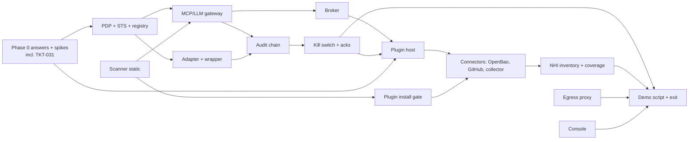

# H. Roadmap

[Package index](README.md) · Previous: [G. MVP](g-mvp.md) · Next: [I. Validation](i-validation.md)

> [!WARNING]
> **All estimates are provisional.** They assume the defaults in [B](b-discovery-questions.md), experienced
> engineers, and no hard enterprise integration deadline. Re-estimate at the end of Phase 0 with spike results.
> Ranges are calendar time for the stated team, not effort sums. The 2026-11-09 additions (EP-21 to EP-23) add
> roughly one month to Phase 1 and one to Phase 2 on the team path.

## Summary

| Phase | Goal | Duration (team-path) | Team | Solo + agents path |
|:--|:--|:--|:--|:--|
| **0** Discovery and security architecture | Close blocking questions, run spikes (incl. plugin contract), accept ADRs | 4 to 6 weeks | 2 to 3 | 4 to 6 weeks (spikes only) |
| **1** MVP | The G slice, passing MVP-1..12 | **4 to 6 months** | **5 to 7** | **6 to 9 months**; MVP-9, the stdio wrapper and the GitHub connector may slip |
| **2** Governance, supply-chain and ecosystem expansion | JIT, reviews, approvals, DLP, sandbox, A2A, SIEM, second runtime; Phase 2 connectors and NHI lifecycle; plugin library and developer programme; WFI deterministic | **5 to 7 months** | 8 to 10 | Not realistic in full; pick 3 epics |
| **3** Enterprise hardening | HA, Kubernetes, multi-tenancy, Entra/Okta/SCIM, pen test, ASVS L2 evidence; Phase 3 connectors; WASM plugins; WFI semantic | 4 to 6 months | 8 to 10 | Not realistic |
| **4** Advanced scoring and autonomous oversight | Explainable scores incl. NHI hygiene, independent evaluators, collusion research, OS mediation research, WFI calibration | 6+ months, research-led | 4 to 6 + researchers | Selected research items |

## Phase 0: Discovery and security architecture

| | |
|:--|:--|
| **Work** | Answer B Q1 to Q6, Q13 and Q14; spikes TKT-001 (gateway build-vs-adopt), TKT-002 (Cedar in Go), TKT-003 (PoP tokens), TKT-004 (runtime hook contract inventory, R1), **TKT-031 (plugin contract `v1alpha1` + host prototype, decides ADR-15)**; **verify connector API scopes [V] for GitHub (Apps, installations, deploy keys, PAT policy, Actions secret names) and OpenBao (KV v2, AppRole, transit, lease listing; Vault parity)**; re-rate threat model incl. T-23 to T-27; sizing model for events (NFR-09, 1,000 events/s [DS]) and NHIs (NFR-18); dev Compose skeleton |
| **Skills** | Security architect, IAM/OAuth engineer, Go engineer |
| **Dependencies** | Stakeholder time for B; access to target runtimes; a GitHub test org and an OpenBao dev instance for scope verification |
| **Milestones** | M0.1 questions answered (wk 2) · M0.2 spikes reported incl. TKT-031 (wk 4) · M0.3 ADRs accepted (ADR-15 may stay Spike until M1.3), Phase 1 plan re-estimated (wk 6) |
| **Risks** | Hook APIs too weak to block (→ runtime becomes observed-only; MVP scope changes); Cedar Go gaps (→ Rust PDP or OPA); GitHub API doesn't expose a needed NHI object (→ connector scope shrinks, documented in coverage) |
| **Exit criteria** | ADR-01..17 Accepted, Spike or replaced; MVP runtime confirmed to support blocking hooks; plugin contract draft reviewed by one engineer who didn't write it; Phase 1 backlog estimated by the people doing it |

## Phase 1: MVP

| | |
|:--|:--|
| **Work** | EP-01, 03, 04, 05, 06, 07, 08, 09, 10 (static), 11, 12, 13, 16 (observe), **21 (contract, two read-only connectors, config collector as plugin, NHI type, exact-key reconciliation, `ownerless` finding, coverage rows), 22 (contract, host, Go SDK, template, harness, conformance, install gate, `disable_plugin`), 23 (FR-WFI-01 fields only)** per [J](j-backlog.md) |
| **Skills** | 2 Go backend (gateway, PDP/STS), 1 Go/systems (adapter, wrapper, egress), **1 Go (plugin host, SDK, connectors)**, 1 frontend (React), 1 AppSec (scanner rules, abuse suite, plugin manifest rules), 0.5 SRE |
| **Dependencies** | Phase 0 exit; OpenBao, Keycloak, Envoy configs; GitHub test org with Apps and deploy keys seeded |
| **Milestones** | M1.1 registry + STS + PDP with policy tests (month 1) · M1.2 MCP + LLM gateway enforcing, both adapters (month 2) · M1.3 adapter, wrapper, egress, broker (month 3) · **M1.4 plugin host + install gate + first connector (OpenBao) syncing (month 3 to 4)** · M1.5 audit chain, kill switch incl. `disable_plugin`, GitHub connector, NHI inventory, console (month 4 to 5) · M1.6 demo script green, outsider connector test, exit review (month 5 to 6) |
| **Risks** | MCP spec revision during build (pin a version, adapter abstraction at message level); latency target missed (measure early in M1.2); scope creep into P1 features; **plugin contract redesigned mid-phase** (one redesign budgeted after the OpenBao connector; none after); **GitHub rate limits or scope gaps slow the connector** (fixture replay, documented gaps) |
| **Exit criteria** | [G §5](g-mvp.md#5-mvp-exit-review) |

## Phase 2: Governance, supply-chain and ecosystem expansion

| | |
|:--|:--|
| **Work** | EP-14 (JIT, requests, approval inbox full, reviews incl. NHIs, SoD), EP-15 (classification, PII/PHI detectors with measured precision, taint rule), EP-10 P1 (sandbox dynamic runs, scheduled + advisory re-scan, signed attestations, trust tiers), EP-16 (A2A enforcement), EP-17 (SIEM export, Jira/ServiceNow, Slack/Teams approvals as plugins), second runtime adapter (e.g. Codex CLI **[V]** hook support), Python/TS SDK interceptors, SPIFFE/SPIRE for server agents [DS], policy simulation and CI tests. **EP-21:** Phase 2 connector set (AWS IAM, Entra ID / Azure, GCP, Okta, Kubernetes, AD/LDAP, GitHub Actions / GitLab CI secrets, n8n) **[V]** scopes each; heuristic reconciliation and conflict UI; remaining hygiene findings; lifecycle actions with two-person approval, dry-run and rate limits; `revoke_nhi` via kill switch; NHIs in access reviews and exports. **EP-22:** plugin library index and in-console browser; submission pipeline with `community` / `verified` tiers; Python and TypeScript SDKs; scanner, detector, notification, console-panel and policy-pack types; developer programme launch: "Build a plugin" pages, template repos per type, tutorials, wanted-connectors list, contract changelog. **EP-23:** telemetry-derived fingerprints, deterministic overlap detection, `idle_workflow` and `credential_consolidation` classes, proposal lifecycle, optimization inbox, workflow map, savings estimates |
| **Skills** | + IGA specialist, + ML engineer (detectors, evaluation), + integration engineer (connectors), + second frontend, **+ developer-relations / technical writer for the plugin programme, + data engineer for WFI** |
| **Milestones** | M2.1 access governance live incl. NHIs (month 2) · M2.2 sandbox + re-scan; plugin library open with `community` tier (month 3) · M2.3 A2A + second runtime; four cloud/IdP connectors live; first lifecycle action in production (month 4 to 5) · M2.4 SIEM + ITSM; WFI findings shipping to an optimization inbox; developer programme launch (month 5 to 7) |
| **Risks** | Detector false positives eroding trust (ship in flag mode first, measure, then block); A2A spec churn **[V]**; **connector write actions misused** (approval + rate limit + dry-run before any write scope is approved); **library moderation load** (automated pipeline first, `verified` review budgeted); **WFI false positives** (findings with evidence, measure accept rate before promoting the class) |
| **Exit criteria** | Governance flows auditable end to end on two runtimes; DLP detectors have published precision/recall on our test set; quarterly access review incl. NHIs completed in a pilot; **≥ 6 connectors live with documented scopes; ≥ 1 lifecycle action executed through a connector with full audit; ≥ 3 plugins from outside the core team listed; WFI deterministic class has a measured accept rate on the lab fleet** |

## Phase 3: Enterprise hardening

| | |
|:--|:--|
| **Work** | EP-18: Helm chart, HA gateway/API/PDP, Postgres HA, DR runbooks + tested restore, NATS + ClickHouse event pipeline, multi-tenant console and delegated admin, Entra ID / Okta / SCIM, mTLS everywhere, external audit anchoring, customer-owned KMS/HSM for all signing keys [DS], upgrade/migration tooling, third-party pen test, ASVS L2 evidence, release supply chain (SBOM, signed images, same for first-party plugins). **EP-21:** Phase 3 connectors (SailPoint, CyberArk, Snowflake, Databricks, Slack apps, ServiceNow, Salesforce) **[V]**; connector scale test (50,000 NHIs in ≤ 15 min, NFR-18); plugin host isolation in Kubernetes. **EP-22:** WASM hot-path plugin spike (wazero / Extism **[V]**) for detectors with a latency budget; `runtime_adapter` plugin type; partner verification programme. **EP-23:** semantic similarity layer with a local embedding model (licence **[V]**), precision measured before default-on |
| **Skills** | + SRE x2, + security engineer (internal red team), + technical writer |
| **Milestones** | M3.1 HA + DR test (month 2) · M3.2 multi-tenancy with isolation suite; connector scale test (month 3 to 4) · M3.3 pen test + fixes incl. RT-7/RT-8 findings (month 5) · M3.4 GA readiness review (month 6) |
| **Risks** | Multi-tenant isolation bugs (T-18) → isolation tests as release gate; **WASM host immaturity** → detectors stay out-of-process |
| **Exit criteria** | NFR-07 99.9 % in a 30-day soak; zero High pen-test findings open; restore tested; isolation suite green; connector scale target met |

## Phase 4: Advanced scoring and autonomous oversight

| | |
|:--|:--|
| **Work** | EP-19 explainable scores (security trust, operational quality, residual risk, compliance posture, **NHI hygiene**) with evidence, decay, overrides, appeals, anti-gaming; EP-20 independent evaluator agents, quorum rules with diversity requirements (different model families/providers), collusion and circular-validation research (R7), OS-level mediation research or EDR integration (R6 follow-up). **EP-23:** savings calibration against verified proposals, `shared_service_opportunity` and `pass_through_chain` classes, WFI signal into residual risk (never a permit) |
| **Skills** | Research engineers, data scientist, security researcher |
| **Exit criteria** | Each score has documented inputs, calibration against labelled incidents, and a policy linter proving no score, plugin output or WFI finding can grant a tier 2/3 action (ADR-14, FR-POL-09) |

## Critical path

## Top delivery risks

| Risk | Likelihood | Impact | Mitigation |
|:--|:--|:--|:--|
| Runtime hook APIs change or can't block some tool types | High | High | Phase 0 inventory; adapter per runtime version; coverage panel tells the truth |
| MCP / A2A spec revisions mid-build | High | Medium | Pin versions; message-level adapter; conformance tests |
| Gateway latency over budget | Medium | Medium | Measure at M1.2; embedded PDP; async ML |
| Scope creep from "command center" breadth | High | High | MVP exit criteria are the only definition of done; P1 items parked in J |
| Building what an open-source gateway already does | Medium | Medium | TKT-001 spike before writing gateway code |
| Solo-builder bandwidth | High (if Q12 default holds) | High | Solo path narrows Phase 1 to gateway + PDP + audit + kill + plugin host with one connector; adapter, egress and the second connector follow |
| **Plugin contract churn before v1** | Medium | High | One redesign budgeted in Phase 1 after the first connector; freeze at MVP exit; two-minor deprecation rule (NFR-19) |
| **Platform API or scope changes break connectors** | High (over years) | Medium | Pin API versions; conformance against recorded fixtures (connector replay suite); coverage shows the gap instead of hiding it |
| **Library moderation and support load** | Medium | Medium | Automated scan + conformance for `community`; `verified` only after review; tiers labelled in console and index; takedown procedure |
| **WFI false positives erode trust** | Medium | Medium | Ship as findings with evidence; measure accept rate per class before promoting; semantic layer only after precision is published |
| **"Manage NHIs" grows into an IGA product** | High | High | ADR-16 boundary: act through platforms, never the system of record; no provisioning, no access-request UI for NHIs beyond what EP-14 already has |

## Cross-check against the DeepSeek estimates [DS]

The DeepSeek run estimated in total engineering person-weeks (pw) for a small senior team. Both are provisional;
the gap is mostly the plugin platform and connectors, which DeepSeek did not scope.

| Phase | DeepSeek (pw) | This package (calendar, team path) | Rough equivalence |
|:--|:--|:--|:--|
| 0 | 2 to 4 pw | 4 to 6 weeks, 2 to 3 people | 8 to 18 pw: this package runs five spikes, DeepSeek one |
| 1 | 8 to 14 pw | 4 to 6 months, 5 to 7 people | 90 to 180 pw: DeepSeek's slice had no runtime adapter, egress, plugin host or connectors |
| 2 | 10 to 16 pw | 5 to 7 months, 8 to 10 people | DeepSeek's Phase 2 maps to about a third of this one |
| 3 | 12 to 20 pw | 4 to 6 months, 8 to 10 people | Similar scope, different effort assumptions |

Treat the DeepSeek numbers as a lower bound for a demo-grade build and this package's ranges as the
production-grade build; re-estimate from [J](j-backlog.md) at the end of Phase 0.
