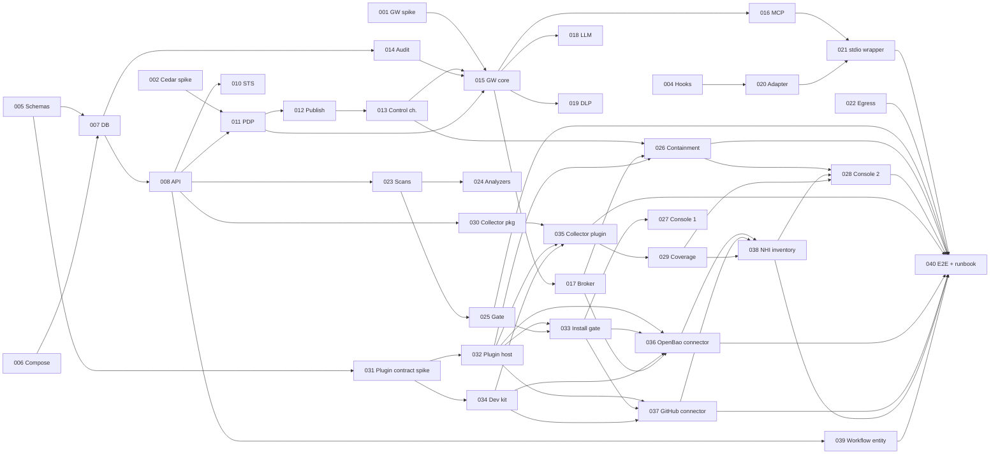

# J. Backlog

[Package index](README.md) · Previous: [I. Validation](i-validation.md) · Next: [K. Next steps](k-next-steps.md)

Epics are defined in [C §1](c-requirements-catalog.md#1-epics). Below: the first 40 tickets, in dependency order,
covering Phase 0 and Phase 1. Size: **S** ≤ 3 days, **M** ≤ 2 weeks, **L** ≤ 4 weeks (one engineer;
provisional). TKT-001 to 030 come from the Claude run (TKT-030 narrowed); TKT-031 to 039 are the 2026-11-09
additions; TKT-040 folds in the DeepSeek run's end-to-end acceptance and demo-runbook tickets [DS].

**Definition of done (all tickets):** code reviewed; unit tests; relevant abuse/conformance tests added and green;
events emitted per [F §4](f-data-contracts.md#4-event-schema); no secrets in code, logs or fixtures; API changes in
OpenAPI; docs updated; runs in the Compose stack; coverage class recorded where the ticket adds a path [DS];
**first-party plugins use only the public plugin contract** (FR-PLG-15); **connector tickets document the
platform API scopes they need, marked [V] until confirmed** (FR-CON-05/10).

## Phase 0

| Ticket | Title | Epic | Size | Depends | Done when |
|:--|:--|:--|:--|:--|:--|
| **TKT-001** | Spike: gateway build vs adopt (agentgateway, Envoy AI Gateway) **[V]** | EP-05 | M | — | Report scores 5 criteria in ADR-04; recommendation accepted |
| **TKT-002** | Spike: Cedar in Go: schema validation, entity hierarchy, context records, perf with 500 policies / 5k entities | EP-04 | M | — | Parity matrix vs Rust reference; p99 measured; ADR-03 accepted or fallback chosen |
| **TKT-003** | Spike: proof-of-possession for laptop agents (DPoP vs mTLS-bound vs signed requests) | EP-03 | S | — | Recommendation per client capability; ADR-06 updated |
| **TKT-004** | Inventory runtime hook contracts (Claude Code, Codex CLI, others): blocking? which tools? stdin/stdout format? version stability **[V]** | EP-07 | S | — | Table in E §18 R1 filled; MVP runtime confirmed |
| **TKT-005** | JSON Schemas for registry entities (incl. `nhi_account`, `connector`, `plugin`, `workflow`), event envelope, token claims, plugin manifest; validator CLI | EP-01, EP-11, EP-21, EP-22 | M | — | Schemas in repo; CI validates fixtures |
| **TKT-006** | Compose dev stack: Postgres, Keycloak (realm import), OpenBao (dev unseal script), Jaeger, Envoy egress skeleton, plugin host placeholder | ops | M | — | `docker compose up` gives a working stack with seed data; README |
| **TKT-031** | Spike + build: plugin contract `v1alpha1` proto (`Plugin.Describe`, `Plugin.Health`, `Connector` service), Go SDK skeleton, generated reference docs, prototype out-of-process host with a capability-scoped token; decides ADR-15 | EP-22 | M | 005 | A hello-world connector runs under the prototype host, is refused an out-of-scope call, and its events carry `plugin_id`; ADR-15 moves from Spike to Proposed or is rewritten; **[V]** connector API scopes for GitHub and OpenBao recorded |

## Phase 1

| Ticket | Title | Epic | Size | Depends | Done when |
|:--|:--|:--|:--|:--|:--|
| **TKT-007** | Postgres schema v1: assets, edges, grants, findings, exemptions, containment, peps, **nhi_accounts, connectors, plugins, workflows**; RLS by `tenant_id`; migrations | EP-01 | M | 005, 006 | Migrations up/down; RLS test proves cross-tenant read fails |
| **TKT-008** | Mgmt API: asset CRUD, lifecycle transitions with owner/backup validation, OIDC auth | EP-01 | M | 007 | FR-REG-01..03 tests; OpenAPI published |
| **TKT-009** | Relationship graph + blast-radius endpoint (recursive CTE), incl. `uses_nhi` and `observed_by` edges | EP-01 | S | 008 | FR-REG-05 query returns reachable tools/creds/NHIs/resources, and agents per NHI |
| **TKT-010** | STS: instance enrolment (Ed25519 key), token exchange, transaction tokens signed via OpenBao transit, JWKS | EP-03 | L | 003, 008 | FR-IAM-02/03/06; ABUSE-08, -12 green |
| **TKT-011** | PDP package: Cedar schema, bundle compiler (registry → entities + pins), decide API, explain API; linter rule for FR-POL-09 | EP-04 | L | 002, 008 | FR-POL-01..05, 09; policy unit tests; p99 benchmark recorded |
| **TKT-012** | Policy store + publish flow: validate, version, sign bundle, epoch | EP-04 | M | 011 | Invalid policy rejected with location; FR-POL-03 |
| **TKT-013** | Control channel: gRPC Subscribe/Ack/Heartbeat, Postgres NOTIFY fan-out, epoch monotonicity | EP-12 | M | 012 | FAIL-10, FAIL-11 green; PEP list shows heartbeats |
| **TKT-014** | Audit writer: hash chain, INSERT-only role, checkpoint signing + WORM export (local MinIO with object lock in dev), verifier CLI; production profile refuses dev signing keys (FR-SEC-05) | EP-11 | M | 007 | FR-TEL-03; tamper tests (modify, delete, insert, reorder) detected |
| **TKT-015** | Gateway core: token verification, embedded PDP, obligation engine (deny on unknown), event emission, OTel spans | EP-05 | L | 001, 011, 013, 014 | PEP conformance suite skeleton green |
| **TKT-016** | MCP adapter (Streamable HTTP): OAuth 2.1 resource-server posture + RFC 9728 metadata [DS] **[V]**, session handling, `tools/list` filter, `tools/call` authz with normalized args, description/schema pinning, server→client requests blocked | EP-05 | L | 015 | FR-GW-01..05; ABUSE-01..06 green |
| **TKT-017** | Credential broker: `inject_credential` obligation, OpenBao KV read with gateway role, lease revocation hook; **host-bound brokered credentials for plugins** (FR-SEC-06) | EP-09 | M | 015 | FR-SEC-01/02/06; secret scan over logs/DB = 0 |
| **TKT-018** | LLM adapters: Anthropic Messages (stream + non-stream) **and** OpenAI-compatible chat; model allowlist; token/cost metering; task budgets with atomic decrement | EP-06 | M | 015 | FR-GW-06; FR-MAO-01; ABUSE-15 budget part; both adapters pass the same scenarios |
| **TKT-019** | Deterministic DLP detectors on tool args and LLM requests (key formats, PEM, Luhn PAN, IBAN) | EP-15 | S | 015 | ABUSE-16 ≥ 99 % on test set; FP rate on clean corpus recorded |
| **TKT-020** | `ascc` agent binary: runtime adapter (hook handler for MVP runtime), local decision cache, heartbeat, enrolment CLI | EP-07 | L | 004, 010, 013 | FR-RT-01, FR-RT-03; ABUSE-18 green |
| **TKT-021** | stdio MCP wrapper (same binary): child process mgmt, JSON-RPC proxy reusing the MCP package from TKT-016 | EP-07 | M | 016, 020 | Conformance suite passes over stdio; kill terminates child |
| **TKT-022** | Egress: Envoy forward proxy config, ext_authz callout → PDP, per-agent **and per-plugin** allowlist from bundle, proxy auth | EP-08 | M | 011, 013 | FR-EG-01; ABUSE-13, -14 green |
| **TKT-023** | Scan orchestrator + workers: fetch/pin by digest, gitleaks, OSV-Scanner, Syft/Grype, Semgrep CE runner, SARIF normalization; workers isolated from DB; OCI artifact ingest | EP-10 | L | 008 | FR-SC-01/02; ABUSE-24 static part |
| **TKT-024** | ASCC analyzers: MCP manifest/tool-description rules, skill analyzer (hidden Unicode, instruction-like text, URLs, install scripts), typosquat check | EP-10 | M | 023 | ABUSE-09, -10 green; rule IDs documented |
| **TKT-025** | Scan gate + exemptions: lifecycle wiring, expiring exemptions bound to digest, approval endpoint pins tools | EP-10 | M | 023, 012 | FR-SC-03/04; quarantined asset denied at gateway |
| **TKT-026** | Containment service: suspend agent, disable tool, revoke credential, **disable plugin (shared ack path with the plugin host)**; per-PEP and per-plugin ack tracking; `unconfirmed` escalation; reverse action | EP-12 | M | 013, 017, 032 | FR-KS-01..04, FR-PLG-07; FAIL-06 green; propagation p95/p99 measured |
| **TKT-027** | Console: login, catalog, asset detail, findings + exemption form, **minimal approval inbox and scan queue** [DS] (pending assets and plugin installs with findings and requested capabilities) | EP-13 | L | 008, 025, 033 | MVP screens 1 to 3 and 7 usable; WCAG basics |
| **TKT-028** | Console: session timeline, kill panel (mobile, incl. plugin target), coverage panel (incl. connector rows and `not_connected` platforms), **NHI inventory list with blast radius, installed plugins with health** | EP-13 | L | 014, 026, 029, 038 | MVP screens 4 to 6 and 8; coverage matches E §6 |
| **TKT-029** | Coverage engine: compute enforced/observed/unmonitored per asset and bypass route from PEP heartbeats, discovery reports, config; **connected / `not_connected` / `stale` per connector and declared platform**; A2A endpoint `observed` | EP-11 | M | 013, 030, 035 | FR-TEL-08, FR-CON-07; MVP-8, MVP-12 |
| **TKT-030** | Config-file collector logic as a Go package: known MCP/agent config locations per OS, parse, diff against registry (no transport; consumed by TKT-035) | EP-02 | S | 008 | Package with tests over fixture config trees for Windows, macOS, Linux |
| **TKT-032** | Plugin host: process/container runner, capability-scoped token issuance (approved scopes only), per-plugin egress allowlist via TKT-022, CPU/memory/time limits, health heartbeat, restart with backoff, crash isolation, `disable_plugin` handler, events with `plugin_id` | EP-22 | L | 031, 013, 017, 022 | FR-PLG-04/06/07/14; ABUSE-28 green; FAIL-12 shows 0 ms added to gateway p95 |
| **TKT-033** | Plugin install gate: `plugin` asset type, `plugin.yaml` schema + capability over-request scan rule, signature verification (Sigstore cosign **[V]**), two-person approval surfacing capabilities and scan results, upgrade re-gating on capability increase | EP-22 | M | 032, 025, 012 | FR-PLG-03/05, FR-SC-08 (plugins); ABUSE-29 green |
| **TKT-034** | Developer kit: Go connector template repo, dev harness (mock control plane, fixtures, record/replay of platform API traffic), plugin conformance suite, `ascc plugin init \| dev \| test \| package` | EP-22 | L | 031 | FR-PLG-08 (Go), FR-PLG-09; a hello-world connector built from the template passes conformance in the harness |
| **TKT-035** | Config-file collector as a connector plugin using the TKT-030 package; uploads discovery reports; runs on managed hosts under the adapter's local plugin host | EP-02, EP-21 | S | 030, 032, 034 | FR-REG-06, FR-REG-11; unregistered servers listed as `discovered` with confidence; passes conformance |
| **TKT-036** | OpenBao/Vault connector: KV paths → credential_refs, AppRoles, tokens and leases, transit keys → `nhi_account`; incremental sync with cursor; coverage report **[V]** API parity OpenBao vs Vault | EP-21 | M | 032, 033, 034, 017 | FR-CON-01/05/09/11; conformance + fixture replay green; process env holds no platform secret |
| **TKT-037** | GitHub NHI connector: GitHub Apps and installations with permissions, deploy keys, organization PAT policy, Actions secret names; repositories containing MCP server manifests or agent configs registered as `discovered` **[V]** REST/GraphQL scopes | EP-21 | M | 032, 033, 034 | FR-CON-01/05/09/11/14; conformance + fixture replay green incl. rate-limit and permission-denied fixtures |
| **TKT-038** | NHI inventory: `nhi_account` type and kinds, exact-key reconciliation (ARN, client ID, object ID, vault path + role, key fingerprint), `uses_nhi` / `observed_by` edges, `ownerless` finding, `unlinked` filter, connector coverage rows, freshness, NHI list API | EP-21 | M | 007, 008, 029, 036, 037 | FR-CON-02/03 (exact)/04/06 (`ownerless`)/07; AppRole + GitHub App fixture merges into one record; MVP-12 |
| **TKT-039** | `workflow` entity with fingerprint fields (trigger, inputs, tools, models, destinations, schedule, owner, platform, purpose, rollups); populated from agent registration; API | EP-23 | S | 008 | FR-WFI-01; every registered agent has a workflow record |
| **TKT-040** | End-to-end acceptance suite for MVP-1..12 in CI against the Compose stack, plus the one-command `docker compose up` demo runbook and the outsider-builds-a-connector exit test script [DS] | all | M | 020, 021, 022, 025, 026, 028, 035, 036, 037, 038, 039 | G §3 demo script runs green from a clean stack; MVP-1..12 asserted; runbook followed by someone other than the builder |

## Parked for Phase 2 (epics, not yet ticketed)

EP-14 governance (JIT, requests, full approval inbox, reviews incl. NHIs, SoD, break-glass) · EP-15 probabilistic
DLP + taint rule · EP-10 sandbox + re-scan + attestations + scanner plugins · EP-16 A2A enforcement · EP-17
SIEM/ITSM/chat integrations as plugins · second runtime and SDK interceptors · SPIFFE/SPIRE for server agents
[DS] · policy simulation and CI policy tests as a product feature · identity graph visualisation ·
**EP-21:** FR-CON-03 heuristic reconciliation and conflict UI, FR-CON-06 remaining hygiene findings, FR-CON-08
lifecycle actions with approvals, dry-run and rate limits, FR-CON-10 Phase 2 connector set (AWS IAM, Entra
ID / Azure, GCP, Okta, Kubernetes, AD/LDAP, GitHub Actions / GitLab CI, n8n), FR-CON-11 event-driven sync,
FR-CON-12 kill via connector, FR-CON-13 NHI export and reviews · **EP-22:** FR-PLG-08 Python and TypeScript
SDKs, FR-PLG-10 library index and browser, FR-PLG-11 submission pipeline and tiers, FR-PLG-13 developer
programme pages, scanner / detector / notification / console-panel / policy-pack plugin types (FR-PLG-02,
FR-SC-10, FR-DLP-06, FR-ADM-05, FR-POL-10) · **EP-23:** FR-WFI-02..09 (telemetry fingerprints, deterministic
overlap, idle and credential-consolidation classes, proposal lifecycle, estimates, privacy rules, workflow map).

## Ticket dependency graph (Phase 1 critical path)

